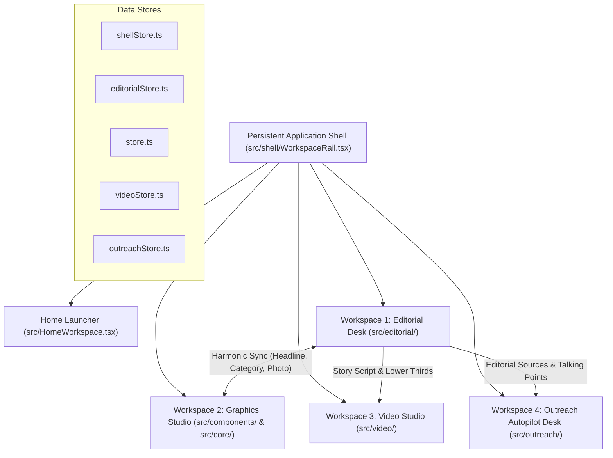
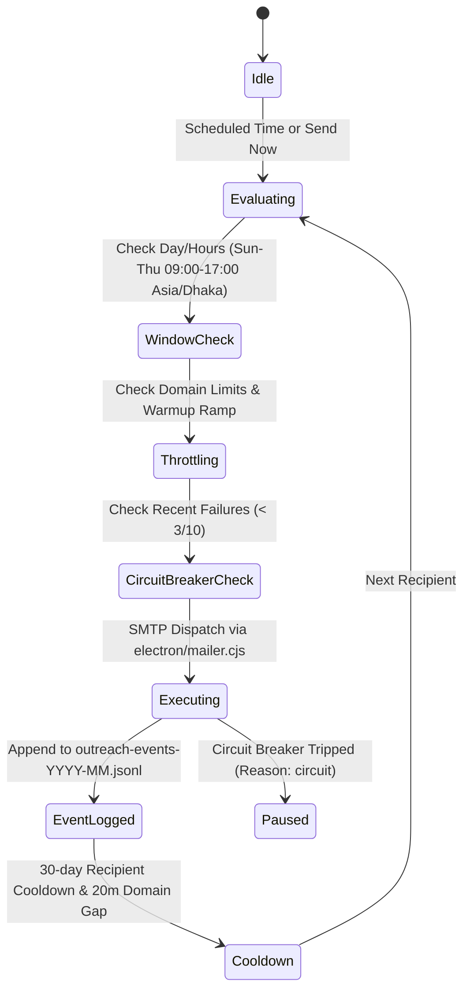

# AGENT.md — ESB Power Line Studio: AI Architecture Dossier & Feature Modeling Guide

> **Document Type:** AI Agent Context Dossier & Free ChatGPT Modeling Framework  
> **Target Product:** ESB AI Studio (`chiefhamim/esb-banner-studio`)  
> **Organisation:** ESB Power Line / Express Broadcast and Communication Ltd. (`esbpowerline.com`)  
> **Desktop Location:** `C:\Users\hamim\Desktop\AGENT.md`  
> **Companion Engineering File:** `C:\Users\hamim\Desktop\CLAUDE.md`  
> **Current Stack:** Electron 45, Vite 8, React 19.3, TypeScript ~6.0.3, Zustand 5, HTML Canvas 2D, WebCodecs (`mediabunny`), Vitest 4, Playwright 1.58, Oxlint  

---

## 🚀 Part 1: How to Connect this Project to Free ChatGPT

If you want to use **Free ChatGPT** (GPT-4o / GPT-4o-mini) to brainstorm, model, plan, and write code for new features for ESB Power Line Studio, follow these 3 practical methods:

### Method 1: Direct File Upload to Free ChatGPT (Recommended & Easiest)
Free ChatGPT supports direct file attachments in chat:
1. Open [chatgpt.com](https://chatgpt.com).
2. Click the **`+` (Add attachment)** button in the chat prompt bar.
3. Select this file: `C:\Users\hamim\Desktop\AGENT.md` (or `CLAUDE.md`).
4. Paste the **Master System Ingestion Prompt** from [Part 2](#-part-2-master-system-ingestion-prompt-for-chatgpt) into the message box along with your feature idea.
5. ChatGPT will read the full architecture, invariants, and constraints, and model your feature with exact file paths, TypeScript types, Zustand store updates, and CSS tokens.

---

### Method 2: If Using ChatGPT Custom GPT or Projects (If Available)
1. In ChatGPT, go to **Explore GPTs** -> **Create a GPT** (or Project).
2. Name: `ESB Power Line Studio Architect`.
3. Under **Instructions**, copy and paste the [Part 2 System Ingestion Prompt](#-part-2-master-system-ingestion-prompt-for-chatgpt).
4. Under **Knowledge / Upload Files**, attach `AGENT.md` and `CLAUDE.md`.
5. Now you have a permanent dedicated assistant that already knows the entire codebase!

---

### Method 3: Copy-Pasting Modular Blocks (Zero Uploads)
If file upload is unavailable or hitting character limits:
1. Copy the **Master System Ingestion Prompt** ([Part 2](#-part-2-master-system-ingestion-prompt-for-chatgpt)).
2. Copy the relevant workspace section from [Part 3](#-part-3-complete-architectural-blueprint--latest-features) (e.g. Outreach Autopilot or Editorial).
3. Use one of the **Prompt Modeling Templates** from [Part 4](#-part-4-prompt-templates-for-feature-modeling).

---

## 🧠 Part 2: Master System Ingestion Prompt for ChatGPT

*(Copy the block below and paste it into ChatGPT as your first prompt)*

```text
You are acting as the Principal Software Architect and World-Class Product Designer (Apple / Linear / Mac-grade craftsmanship) for "ESB Power Line Studio".

REPOSITORY CONTEXT:
- Repository: chiefhamim/esb-banner-studio
- Organization: ESB Power Line / Express Broadcast and Communication Ltd. (esbpowerline.com)
- Brand Rule: The organization name is strictly "ESB Power Line" (with a space). Never "ESB PowerLine".
- Primary Domain: Energy sector newsroom, broadcast media, and outreach communications (Power, Renewables, Gas/LNG, Transmission & Grid, Energy Finance, Policy & Regulation, Regional Energy Trade, Technology & Efficiency).
- Technical Stack: Electron 45, Vite 8, React 19.3, TypeScript ~6.0.3, Zustand 5, HTML Canvas 2D, WebCodecs (mediabunny), Vitest, Playwright, Oxlint.

CORE PRINCIPLES (NON-NEGOTIABLE):
1. MAC-LIKE QUIET CRAFTSMANSHIP:
   - Quiet graphite application chrome; content/canvas is the hero.
   - Spacing: Strict 4px geometry grid (--s-0 through --s-11).
   - Radii: 4px (--r-1), 8px (--r-2), 12px (--r-3), 16px (--r-4), 9999px (--r-pill).
   - Butter-smooth micro-interactions: cubic-bezier(0.16, 1, 0.3, 1), 60fps, 0 CLS (zero layout shifts).
   - Contrast: Minimum 4.5:1. Never use raw hex colors or bright saturated backgrounds in dark mode.
   - Dual theme support: Full high-quality Dark and Light themes via studio.css tokens (--ink, --surface, --card, --fill, --raised, --chip-on-bg, --cat, --sel).
   - Hairline borders: 1px solid color-mix(in srgb, var(--ink) 14%, transparent).

2. ZERO AI SLOP & STRICT EDITORIAL INTEGRITY:
   - Never invent quotes, facts, dates, figures, names, image credits, or sources.
   - Bengali source facts are untouchable: preserve exact numbers, units (MW, MWh, MMCFD, Tk, Crore), and proper nouns.
   - British spelling for common words, but official proper names kept as registered.
   - Character budgets: Headline <= 104, Deck <= 200, Slug <= 75.
   - AI outputs are always editable drafts; never silently overwrite human work.

3. ARCHITECTURAL RIGOR:
   - Zustand stores manage state: src/store.ts (Graphics), src/editorial/editorialStore.ts (Editorial), src/outreach/outreachStore.ts (Outreach), src/video/videoStore.ts (Video), src/shell/shellStore.ts (Shell).
   - Electron IPC isolation: All filesystem, net fetches, and system dialogs route through electron/ipc-guard.cjs and electron/net-guard.cjs with strict parameter validation.
   - No plaintext secrets in logs or git. SMTP app passwords encrypted with DPAPI safeStorage.

When proposing or generating code for new features:
1. Always specify exact file paths.
2. Provide complete TypeScript interfaces and store actions.
3. Adhere strictly to the existing CSS token system in studio.css.
4. Provide Vitest unit tests or Playwright verification steps.
```

---

## 🏛️ Part 3: Complete Architectural Blueprint & Latest Features

The application operates with **one unified persistent shell** containing **4 production workspaces**:



---

### 1. Workspace 1: Editorial Desk (`src/editorial/`)
*Turn Bengali source material into publication-ready English journalism and publish directly to the live CMS.*

- **One-Link Intake (`extract.ts`, `siteAdapters.ts`):**
  - Pasting a Bengali news URL (Prothom Alo, Bonik Barta, Daily Star, Samakal, Channel 24, Barta24) extracts clean Bengali headline, deck, body paragraphs, and high-res photos.
  - Automatically strips publisher self-promotion, copyright boilerplate, and office addresses (Karwan Bazar, BDBL Bhaban, Dhaka-1215).
  - Dedicated adapters for client-rendered news APIs (`backoffice.channel24bd.tv`, `backoffice.barta24.com`).
- **PDF & Word Intake (`importDocument.ts`):**
  - Extracts text locally using `pdf.js` worker and `mammoth.js` (`.docx`, 25MB cap).
  - Detects legacy Bijoy/SutonnyMJ or scrambled Bangla and automatically invokes AI vision fallback (`readPdfWithAi`) to transcribe verbatim.
- **Journalistic Translator Master Prompt (`translator.ts`):**
  - Master prompt: `JOURNALISTIC_TRANSLATOR_PROMPT` (Senior Editor of ESB Power Line).
  - Tone: Clear, publication-grade, active-voice British English for elite energy executives.
  - Facts untouchable: MW vs MWh, capacity vs output, units spaced (`1,200 MW`), lakh/crore glossed.
  - Opening paragraph strictly under 40 words.
  - Strict character budgets: Headline $\le 104$, Deck $\le 200$, Slug $\le 75$.
- **Real-Time Fact Verification (`facts.ts`, `RichReview.tsx`):**
  - Matched facts get green underline (`.fact-verified`).
  - Mismatches or discrepancies get amber wavy underline (`.fact-unverified`).
  - Clicking a source fact chip smoothly scrolls and pulses the match in the story body.
- **Rich Body Editor (`RichBodyEditor.tsx` - TipTap):**
  - CMS-grade tools: H2/H3, bold, italic, underline, strike, highlight, lists, blockquotes, tables, dividers.
  - Inline image uploader (`imageTools.ts`, `uploadBodyImage`) with caption, credit, and alignment (`article-img--*`).
  - Canvas-rendered financial/energy charts (`chart.ts`) generated from data tables.
- **Pre-Flight Readiness & Publishing (`readiness.ts`, `PublishDialog.tsx`, `siteApi.ts`):**
  - 17 Google SEO checks (`seo.ts`) measuring real pixel widths (580px title limit).
  - 14 Social checklist rules (`socialChecks.ts`) for Facebook, X, LinkedIn, Telegram.
  - Supabase CMS direct publication (`public.Article`) with single-use refresh token keep-alive.
  - Automatic banner rendering (16:9 Web JPG) and upload to media library (`/api/upload`).
  - ISR site cache revalidation POST to `esbpowerline.com/api/cms/revalidate`.
  - Facebook Graph API publication (4:5 banner + caption without link, followed by automatic first-comment link).

---

### 2. Workspace 2: Graphics Studio (`src/components/`, `src/core/`)
*Precision Canvas 2D graphic design suite for multi-format newsroom assets.*

- **Canvas 2D Engine (`src/core/render.ts`, `Stage.tsx`):**
  - High-performance 60fps rendering, zoom/pan, safe-area guides, snap-to-grid.
  - Layer hierarchy: background photos, gradients, vector badges, category labels, headlines, kicker, footer credits.
- **6 Newsroom Formats (`src/core/tokens.ts`):**
  - `fb45`: Facebook / Instagram Feed (1080 × 1350, 4:5) — Default
  - `web`: Web Hero Article (1920 × 1080, 16:9)
  - `sq`: Square Social / LinkedIn (1080 × 1080, 1:1)
  - `story`: Vertical Story / Reel (1080 × 1920, 9:16)
  - `social`: High-Res Social Grid (1598 × 1431)
  - `yt`: YouTube Video Thumbnail (1280 × 720, 16:9)
- **8 Energy Sector Categories & Colors:**
  - `01 Power Generation` (`#00E5FF`)
  - `02 Gas & Petroleum` (`#FF9100`)
  - `03 Transmission & Grid` (`#FFEA00`)
  - `04 Renewable Energy` (`#00E676`)
  - `05 Energy Finance & Economy` (`#7C4DFF`)
  - `06 Policy & Regulation` (`#FF1744`)
  - `07 Regional Energy Trade` (`#2979FF`)
  - `08 Technology & Efficiency` (`#E040FB`)
- **Typography & Headline Tuner:**
  - Inter (UI / Headline ExtraBold 800), Oswald (Banner Headings), Hind Siliguri (Bengali).
  - Trucent line-break tuner: optical balance to eliminate orphan words on banners.
  - 2x Retina PNG, WebP, and ZIP export with custom metadata.

---

### 3. Workspace 3: Video Studio (`src/video/`)
*Timeline-based motion packaging and WebCodecs video generation.*

- **WebCodecs Offline Rendering (`exportVideo.ts` via `mediabunny`):**
  - Every frame seeked, drawn to offscreen canvas, and encoded with precise timestamps ($i/\text{fps}$).
  - Guarantees exact playback speed and duration (eliminates `MediaRecorder` clock drift).
  - MP4/H.264 default with 48kHz AAC/Opus offline audio mixing.
- **Multi-Track Timeline (`Timeline.tsx`):**
  - Video tracks (V1 footage/stills, V2 lower thirds/monograms), Audio tracks (A1 voiceover/music).
  - Story-to-Video auto-assembly (`storyVideo.ts`): builds a dynamic rough cut directly from Editorial drafts with animated photo zooms and sentence captions.

---

### 4. Workspace 4: Outreach Autopilot Desk (`src/outreach/`)
*Enterprise autonomous email communications and audience pacing engine.*



- **Headless Engine Loop (`electron/outreach-engine.cjs`, `outreach-jobs.cjs`):**
  - Runs autonomously in the background from the Windows system tray (`electron/tray.cjs`) even when the app window is closed.
  - **Warm-up Ramp:** Calculates safe daily cap: $\text{rampCap}(\text{cap}, d) = \min(\text{cap}, 30 + 20 \times (d - 1))$.
  - **Send Windows:** Strictly Sun–Thu 09:00–17:00 Asia/Dhaka (business days only).
  - **Domain Throttling:** Maximum 3 sends/day per recipient domain with a minimum 20-minute gap between emails to the same domain.
  - **Circuit Breaker:** Automatically trips and pauses the campaign if 3 sends fail within 10 attempts (reason: `circuit`).
  - **7-Day Rule & 30-Day Cooldown:** No repeat email to the same address within 7 days; 30-day global recipient cooldown across all campaigns.
- **Append-Only Event Ledger (`electron/outreach-events.cjs`):**
  - Stored in `userData/outreach-events-YYYY-MM.jsonl`.
  - Records every state change: `send.ok`, `send.fail`, `send.skip`, `send.retry`, `job.*`, `engine.*`.
  - Fast folding for suppression sets and cooldown validation. Guarantees zero duplicate sends.
- **Activity Desk (`ActivityDesk.tsx`, `ActivityOverview.tsx`, `ActivityLog.tsx`):**
  - Full-window interactive dashboard toggled via topbar Activity pill.
  - Custom SVG volume delivery and timing charts.
  - Rolling 24-hour and 30-day deliverability metrics.
  - Live searchable transaction log (All, Sent, Failed, Skipped, System) with CSV export.
- **AI Assistant Operator (`operator.ts`, `commands.ts`, `AssistantDialog.tsx`):**
  - 28 strictly typed commands across 4 safety tiers:
    1. `read`: View status, stats, queues, logs (safe, auto-executed).
    2. `safe`: Draft letters, rewrite copy, run DNS checks (safe, auto-executed).
    3. `confirm`: Start campaigns, pause/resume, import contacts (requires explicit confirmation).
    4. `danger`: Delete campaigns, purge suppressions, reset accounts (strictly refused for AI callers).
  - Caller gating and rate limiting (max 20 actions/hour).
  - Opt-in reply classification (`replyAi.ts`): categorizes incoming replies into `interested | question | not_now | unsubscribe | wrong_person | other` (never auto-sends replies).
- **Deliverability & Validation:**
  - In-app DNS MX and A record verification (`dns.ts`, `electron/outreach-dns.cjs`).
  - Sector-based segmentation (Solar, Wind, Grid, Nuclear, Policy, Finance).
  - Deterministic subject line variant hashing (`fnv1a`).
  - Animated sending indicator button for test emails with calibrated perimeter borders.
  - Clean attachment viewer (`AttachmentViewer.tsx`) for PDFs, DOCX, TXT, CSV, and images.

---

## 🎨 Part 4: Design Tokens & CSS Reference (`studio.css`)

Always use these tokens when generating or styling UI components:

```css
/* Color & Surface Tokens */
var(--ink)              /* Primary text / foreground color */
var(--ink-muted)        /* Secondary text / labels (70% opacity) */
var(--surface)          /* Main desk background (light: #f5f5f7, dark: #18181b) */
var(--card)             /* Card / panel background (light: #ffffff, dark: #222226) */
var(--card-shadow)      /* Subtle card shadow */
var(--fill-hover)       /* Subtle hover background on interactive rows */
var(--raised)           /* Raised segment/chip background */
var(--chip-on-bg)       /* High-contrast active chip in dark mode (#e6e6ec) */
var(--cat)              /* Active energy sector category accent color */
var(--cat-ink)          /* Legible text color when sitting on --cat */
var(--sel)              /* Desaturated accent for selection */

/* Hairline Borders */
border: 1px solid color-mix(in srgb, var(--ink) 14%, transparent);

/* Spacing Grid (4px base) */
var(--s-0): 0px;   var(--s-1): 2px;   var(--s-2): 4px;   var(--s-3): 6px;
var(--s-4): 8px;   var(--s-5): 12px;  var(--s-6): 16px;  var(--s-7): 20px;
var(--s-8): 24px;  var(--s-9): 32px;  var(--s-10): 40px; var(--s-11): 48px;

/* Radii */
var(--r-1): 4px;   /* Small badges / tags */
var(--r-2): 8px;   /* Standard buttons / inputs */
var(--r-3): 12px;  /* Panels / cards */
var(--r-4): 16px;  /* Dialogs / modals */
var(--r-pill): 9999px; /* Pills / status badges */

/* Micro-Interaction Animation */
transition: all 150ms cubic-bezier(0.16, 1, 0.3, 1);
```

---

## 📋 Part 5: Prompt Templates for Feature Modeling

Use these battle-tested prompts when modeling new features in ChatGPT:

### Template 1: Feature Architecture & Scoping
```text
I want to design a new feature for ESB Power Line Studio: [DESCRIBE FEATURE HERE].

Given the architecture in AGENT.md:
1. Which workspace does this belong to (Editorial, Graphics, Video, Outreach, or Shell)?
2. What state needs to be stored in Zustand, and what is the exact TypeScript interface?
3. What Electron IPC handlers or background scripts are needed (respecting electron/ipc-guard.cjs)?
4. What is the step-by-step user flow (including empty states, error states, and keyboard shortcuts)?
5. What CSS classes and design tokens from studio.css should be used?
6. What are the edge cases, security considerations, and potential failure modes?
```

---

### Template 2: Zustand Store & TypeScript Interface Modeling
```text
I need to add [STATE/ACTION] to [editorialStore / outreachStore / store / videoStore / shellStore].

Write the production-grade TypeScript code adhering to:
- Immutable updates with type safety.
- Persistence to localStorage (with schema versioning) or IndexedDB if handling files.
- Shallow selectors for high-performance React re-renders (`useShallow`).
- Error and loading state management.
```

---

### Template 3: React UI Component & Styling Modeling
```text
Generate the React 19 component for [COMPONENT NAME] in ESB Power Line Studio.

Requirements:
- Written in TypeScript (.tsx) with clean functional components.
- Uses the 4px spacing scale (--s-0 through --s-11) and border tokens from studio.css.
- Must look identical in quality to Apple / Linear Mac desktop applications.
- Supports both Light and Dark themes seamlessly without hardcoded hex colors.
- Interactive controls must have minimum 28x28px click targets and active/hover/focus states.
- Includes accessible tooltips (`data-tip`) and keyboard shortcuts.
```

---

### Template 4: Electron IPC & Security Bridge Modeling
```text
Design the Electron main-process IPC handler for [FEATURE] in `electron/[file].cjs`.

Requirements:
- Validate all incoming arguments in `electron/ipc-guard.cjs`.
- Never trust renderer-supplied filesystem paths or URLs.
- If making HTTP requests, route through `electron/net-guard.cjs` with size/timeout caps.
- Return structured error objects `{ ok: boolean, error?: string, data?: any }`.
- Provide Vitest unit test cases for the IPC handler.
```

---

### Template 5: Verification & Acceptance Test Modeling
```text
Write the verification suite for [FEATURE]:
1. Vitest unit tests in `tools/unit/[feature].test.ts`.
2. Playwright E2E scenario in `tools/e2e/[feature]-test.mjs`.
3. Edge case test matrix covering network failure, corrupted data, and boundary limits.
```

---

## 🗂️ Part 6: Repository File Map

```text
chiefhamim/esb-banner-studio/
├── CLAUDE.md                    # Master engineering charter & cloud guidelines
├── AGENT.md                     # AI context dossier & ChatGPT modeling framework
├── package.json                 # Electron 45, Vite 8, React 19, TS 6, Zustand 5
├── vite.config.ts               # Vite build config with dev proxy
├── index.html                   # HTML entry with strict CSP
├── electron/
│   ├── main.cjs                 # Main process lifecycle, window creation, menus
│   ├── preload.cjs              # Context isolation preload IPC bridge
│   ├── ipc-guard.cjs            # Hostile-defense parameter & path validation
│   ├── net-guard.cjs            # SSRF-protected safe network fetcher
│   ├── mailer.cjs               # SMTP dispatch with DPAPI encrypted passwords
│   ├── inbox.cjs                # IMAP read-only inbox reply & bounce monitor
│   ├── outreach-engine.cjs      # Headless autonomous campaign loop
│   ├── outreach-jobs.cjs        # Job queue state transitions & cooldowns
│   ├── outreach-events.cjs      # Append-only JSONL event ledger
│   ├── outreach-schedule.cjs    # Pacing, warmup ramps & business hours
│   ├── outreach-dns.cjs         # DNS MX and A record validator
│   └── tray.cjs                 # Windows system tray daemon
├── src/
│   ├── App.tsx                  # Root shell, lazy desk loader, global tooltips
│   ├── store.ts                 # Graphics Zustand store (Canvas elements, format)
│   ├── shell/                   # Workspace switcher, rail, and global search
│   ├── editorial/               # Workspace 1: Editorial Desk
│   │   ├── editorialStore.ts    # Editorial state (source, draft, readiness)
│   │   ├── EditorialWorkspace.tsx # 3-column newsroom layout
│   │   ├── extract.ts           # News article HTML scraper & normalizer
│   │   ├── translator.ts        # Master prompt, AI providers, character budgets
│   │   ├── facts.ts             # Source vs draft figure verification engine
│   │   ├── RichBodyEditor.tsx   # TipTap CMS editor with tables & charts
│   │   ├── readiness.ts         # Pre-flight readiness rules & checklists
│   │   ├── seo.ts               # 17 Google SEO checks
│   │   ├── socialChecks.ts      # 14 Social channel verification checks
│   │   ├── siteApi.ts           # Supabase CMS auth, article CRUD, revalidation
│   │   └── facebook.ts          # Facebook Graph API posting & link comment
│   ├── components/              # Workspace 2: Graphics Studio
│   │   ├── Stage.tsx            # Canvas 2D interactive artboard
│   │   ├── Panels.tsx           # Graphics inspector & layer properties
│   │   ├── FormatPicker.tsx     # 6 newsroom formats adapter
│   │   └── ExportDialog.tsx     # 2x Retina PNG/WebP exporter
│   ├── video/                   # Workspace 3: Video Studio
│   │   ├── videoStore.ts        # Video timeline, tracks, and clips store
│   │   ├── VideoWorkspace.tsx   # Multi-track editor & preview monitor
│   │   ├── Timeline.tsx         # Track controls, playhead, trimming
│   │   ├── exportVideo.ts       # WebCodecs offline frame encoder (mediabunny)
│   │   └── storyVideo.ts        # Editorial draft to video rough-cut builder
│   ├── outreach/                # Workspace 4: Outreach Autopilot Desk
│   │   ├── outreachStore.ts     # Campaign, contact, and scheduler store
│   │   ├── OutreachWorkspace.tsx # Outreach 3-column workspace
│   │   ├── ActivityDesk.tsx     # Full-window deliverability dashboard
│   │   ├── ActivityOverview.tsx # SVG delivery volume & timing charts
│   │   ├── ActivityLog.tsx      # Filterable transaction event log
│   │   ├── OutreachComposer.tsx # Letter editor with blueprints & previews
│   │   ├── operator.ts          # AI Assistant 28 typed commands router
│   │   ├── commands.ts          # Safety tiers (read, safe, confirm, danger)
│   │   ├── dns.ts               # DNS MX/A record verification
│   │   ├── segments.ts          # Energy sector audience segmentation
│   │   └── compose.ts           # Dynamic placeholder engine & recipient filters
│   └── styles/                  # CSS Design System
│       ├── tokens.css           # 4px geometry, font tracking, radii
│       ├── primitives.css       # Buttons, segmented controls, inputs, tabs
│       ├── studio.css           # Mac-grade surfaces, chips, themes, motion
│       ├── outreach.css         # Outreach cards, composer, attachment tray
│       └── outreach-activity.css # Activity Desk charts, logs, metrics
└── tools/                       # Testing & Verification Infrastructure
    ├── unit/                    # Vitest test suites (61+ test files)
    ├── e2e/                     # Playwright & Electron E2E test runners
    └── audit/                   # Geometry, contrast, text-fit & CSS census
```

---

## ⚡ Part 7: Standard Verification Commands

Before committing or testing any newly modeled feature, execute the standard verification pipeline:

```bash
# 1. Typecheck & Build (Vite 8 + TypeScript)
npm run build

# 2. Run All Unit Tests (Vitest, 550+ tests)
npm test

# 3. Oxlint Check
npm run lint

# 4. CSS Token & Property Census (ensures 0 duplicate or off-scale tokens)
npm run census

# 5. Editorial Headless Test
npm run test:editorial

# 6. Golden Banner Visual Regression Test
npm run test:golden
```
