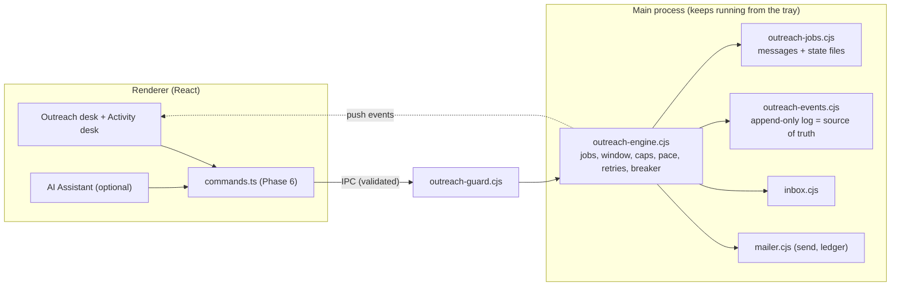

# Outreach Autopilot — Implementation Plan

> **Audience:** the implementing agent (Gemini 3.8 Flash, High). **Approver:** Hamim.
> **Status:** DRAFT for review — nothing in this document has been implemented.
> **Repo:** `chiefhamim/esb-banner-studio` · **Desk:** Outreach (`src/outreach/`, `electron/mailer.cjs`, `electron/inbox.cjs`)
> **Written by:** Claude Sonnet 5.5 after a full read of the Outreach code (see §3). Findings are from a static read, not a run.

---

## 0. How to use this document

### 0.1 Kick-off prompt (paste this when Hamim says "go")

```text
You are the implementer for the ESB AI Studio "Outreach Autopilot" work.
1. Read docs/OUTREACH_AUTOPILOT_PLAN.md completely, top to bottom, including the appendices. Then read CLAUDE.md sections 2, 8, 9, 10, 11, 12 and the Outreach part of section 3.
2. Do Phase 0 exactly as written. Do not skip it.
3. Then do Phases 1 to 7 in order, one numbered step at a time. After every step run that step's "Accept" checks. Commit after every green step.
4. Create docs/OUTREACH_AUTOPILOT_PROGRESS.md in Phase 0 and update it after every step (step id, commit hash, commands run, result).
5. If a step's precondition is false, an Accept check stays red after two honest fix attempts, or anything in section 2.2 (Forbidden) would be needed: STOP, write the problem into the progress file, and report to Hamim. Never improvise around a red check.
6. Never claim a step is done without having run its Accept commands and read their output.
```

### 0.2 Authority order (when sources disagree)
1. Section 2 (Rules) and Section 5 (UI/UX) of this document.
2. The behaviour specified in Sections 4 and 6.
3. `CLAUDE.md`.
4. The existing code. **Existing code wins only on naming** (a real file/function name that differs from this plan). If you rename something in a step, write the deviation in the progress file. The *behaviour* in this plan still has to hold.

### 0.3 What "done" means for Hamim (plain words)
- A campaign to **thousands** of contacts runs **by itself**, across many days, inside a send window (default Sunday–Thursday, 09:00–17:00 Dhaka time), at an even pace, **with the window closed** (from the tray icon).
- Each person gets the **right letter for their sector**, filled from their own row (including address and other columns), with a safe fallback when a field is empty.
- Every email is **checked automatically**. Only **exceptions** come to Hamim ("Needs you"), never thousands of emails to read.
- **Pause, Resume, Stop** work for one campaign and for everything at once, and are always visible.
- A full-window **Activity** desk shows what was sent, when, how long it took, failures, replies, bounces, with charts, a searchable log, and exportable reports.
- An optional **AI Assistant** can operate the app through the same commands as the buttons, with permission levels and an audit log. **With no AI key, everything still works by hand.**
- **Nothing that works today is broken.** The three-column desk, its look, and its safety rules stay.

### 0.4 Non-goals (do not build these)
- No change to the Editorial, Graphics or Video desks.
- No new sender types (no SES/Brevo/SendGrid integration). Gmail/Workspace via SMTP app password only. (Settings stay compatible with other SMTP hosts, as today.)
- No open or click tracking (the site has no endpoint; the app must not claim it).
- No new npm dependencies. Charts are hand-written SVG. If you believe one is unavoidable: STOP and ask.
- No new AI provider roles (`AiRole` stays as is). The assistant uses the existing `outreach` role; reply reading uses `review`.
- No rewriting of working subsystems "because it would be cleaner" (CLAUDE.md §11 rule 3).

---

## 1. The problems being solved (verified in code)

| # | Problem | Evidence |
|---|---|---|
| P1 | The send loop lives in the React window, so it stops when the window closes; the app quits on window close | `campaign.ts startBatch` (a `for` loop with `setTimeout`); `main.cjs` `window-all-closed` → `app.quit()` |
| P2 | A batch ends "paused — N left for another day" and **nothing resumes it** | `campaign.ts` `finish(left ? 'paused' : 'done')`; `startScheduler` only starts `status === 'scheduled'` |
| P3 | One letter per campaign; four fixed placeholders; unmapped columns (e.g. address) are dropped; a missing field **skips the contact** | `compose.ts fill/missingFields`, `directory.ts contactsFromRows`, `types.ts Contact` |
| P4 | The AI works on one template, before sending, as advice. It cannot act on the app and never sees the final per-person email | `outreachAi.ts`, `reviewLetter` "Advice only", `checks.ts` runs on the template |
| P5 | Send records are in three places; the main ledger is trimmed to 30 days and **5,000 entries** | `mailer.cjs:293` `.slice(-5000)`; `campaign.sent`; `overlay()` |
| P6 | A failed address is retried at every later batch, forever; errors are classified by regex on message text, so one recipient's "mailbox over limit" **pauses the whole campaign** | `compose.ts skipReason` has no FAILED rule; `campaign.ts` `/password\|auth\|login\|credential\|limit/i` |
| P7 | No send window, no per-domain throttle, no warm-up ramp, no circuit breaker | absent from `mailer.cjs` and `campaign.ts` |
| P8 | Approval is one address at a time; there is no in-app MX/syntax check | `OutreachInspector.tsx` `s.approve`; no `resolveMx` anywhere |
| P9 | Activity is a session-only popover list; nothing persists; no times, durations, charts or reports | `OutreachActivity.tsx` reads `s.log` (not saved) |

---

## 2. Rules for the implementer

### 2.1 Hard rules (every step)
1. **Read before you edit.** Open every file you will change in full. Never edit from memory of this document.
2. **One step at a time.** Do not start step N+1 until step N's Accept checks are green and committed.
3. **Smallest possible diff.** Do not reformat, rename, reorder or "tidy" code you were not asked to change. Preserve every existing comment and docstring that is not directly replaced by your change.
4. **Line endings: the repo files use CRLF.** Keep them. After editing run `git diff --stat`; a file showing hundreds of changed lines for a small edit means you changed its line endings: revert that file and redo the edit.
5. **TypeScript strict stays strict.** No `any`, no `@ts-ignore`, no `eslint-disable` that is not already in the file. Run `npx tsc -b` after each file group.
6. **No fake work (CLAUDE.md §11.5).** No dummy buttons, mocked success, or hard-coded numbers shown as real. Anything not implemented yet is **not rendered**.
7. **Never invent data in the UI.** Every figure comes from the event log, the engine, or the contacts. Empty means empty ("Nothing sent yet"), not a placeholder number.
8. **Security stays.** The renderer is treated as hostile by the main process: every new IPC argument is validated in `electron/outreach-guard.cjs`. No secrets in the renderer. The app password never leaves the main process.
9. **Existing tests stay green.** Never edit an existing test to make it pass, except where this plan names the test and says how. If an existing test fails and the plan does not mention it: STOP.
10. **Tests with every behaviour.** Each new pure function or engine rule gets a Vitest test in `tools/unit/` with synthetic `example.com` data only. Never use real addresses, the real mailing list, or real credentials in any test, fixture, log or commit.

### 2.2 Forbidden (stop and report instead)
- `git push` (anything), `git push --force`, `git reset --hard` on shared work, `git clean -fd`, rewriting history.
- Sending any real email during development or testing. Real SMTP is used only by Hamim. All your runs use **dry-run mode** (§4.9).
- Reading, printing, copying or committing anything from `AppData\Roaming\ESB Banner Studio` (it holds the encrypted app password, the ledger and the real campaigns).
- Deleting or modifying `electron/assets/*`, `build/icon.*`, `tools/golden/*`, `esb-logo.png`, `esb-avatar.png`.
- Adding npm packages, changing `package.json` dependencies, or committing `package-lock.json` changes you did not cause (it is already modified in the working tree; do not stage it unless a step adds a dependency — none do).
- Calling any AI provider from tests (tests mock `aiJson`).
- Weakening a security check, a cap, a gap floor or a validator to make something pass.

### 2.3 Environment gotchas (Windows, PowerShell 5.1, Node 26)
- **Never pass PowerShell code containing `$_` inside `powershell -Command "..."`**: the variable is stripped and the command breaks. Write a `.ps1` file in the scratch folder and run it with `powershell -ExecutionPolicy Bypass -File`, or use a small `node` script.
- Use forward slashes in `node`/`vitest` file arguments.
- The repo's auto-sync daemon would corrupt your work — Phase 0 stops it (§6, step 0.2).
- `npm run app` rebuilds and launches the real app against the real profile. **Do not run it.** Use the e2e script with an isolated profile (§7.3).

### 2.4 Verification commands (from CLAUDE.md §10)
```bash
npx tsc -b                      # typecheck only (fast; run often)
npm run build                   # tsc -b && vite build
npm test                        # vitest run (all of tools/unit)
npm run lint                    # oxlint
npm run test:electron           # launches Electron with an isolated profile
npm run test:ui                 # UI e2e
npm run test:editorial          # must stay green (shared shell)
npm run audit:text-fit          # must stay at 0 problems
npm run audit:center
npm run audit:contrast
npm run audit:a11y
npm run census -- --strict      # duplicate/undefined CSS custom properties
```
Baseline numbers are recorded in Phase 0 and **may never get worse**.

### 2.5 Git workflow
- Branch `outreach-autopilot` from `main`. Commit after each green step. Message: `feat(outreach): <step id> <what>` (`fix(outreach)` / `test(outreach)` where apt).
- Never commit `package-lock.json`, anything under `release-*`, `dist/`, `node_modules/`, or any `outreach-*.json(l)` data file.
- You never merge to `main` and never push. Hamim merges after reviewing. (Pushing to `main` updates his running app automatically through the sync daemon.)

---

## 3. Current-state map (so you do not have to rediscover it)

| File | What it does today | Touched by |
|---|---|---|
| `src/outreach/types.ts` | `Contact`, `Campaign`, `Source`, `Template`… | 4.1, 5.1 |
| `src/outreach/outreachStore.ts` (459 lines) | One Zustand store: campaigns/signatures/templates (localStorage `esb-banner-studio/outreach/v2`), contacts (from IndexedDB `list:{id}`), run state, mail status, session `log` | 2.x (small additions only) |
| `src/outreach/campaign.ts` (300 lines) | `eligible`, `mailFor`, `startBatch` (the loop), `pause/resume/stopBatch`, `followUpQueue`, `startScheduler`, `resultsCsv`, `sendTest` | 2.2, 2.3 |
| `src/outreach/compose.ts` | placeholders, `fill`, `missingFields`, `skipReason`, opt-out line | 4.1 |
| `src/outreach/checks.ts` | deterministic letter checks | 4.4 |
| `src/outreach/outreachAi.ts` (415 lines) | blueprints, `writeOutreachWithAi`, `rewriteLetter`, `fixLetterWithAi`, `researchSource`, `reviewLetter` | 5.x, 6.x |
| `src/outreach/directory.ts` | workbook/CSV parser → `Contact[]` | 4.1 |
| `src/outreach/OutreachWorkspace.tsx` | the desk frame: header (menus, campaign chip, Activity popover, AI chip, sender), `.or-body` 3 columns, status bar, dialogs | 2.5, 3.7 |
| `src/outreach/OutreachInspector.tsx` (369 lines) | right column: Send / Contact / Review tabs, `SendFooter` | 2.4, 4.4 |
| `src/outreach/OutreachDialogs.tsx` (408 lines) | `ReviewSendDialog`, `FollowUpDialog`, signatures, footer… | 2.6 |
| `src/outreach/outreachUi.ts` | UI state (`left`, `right`, `view`, `sheet`) and `ask()` | 2.x, 3.7 |
| `src/outreach/OutreachActivity.tsx` | header clock button + floating popover of the session log | 3.7 |
| `src/styles/outreach.css` (423 lines) | all Outreach styling, classes `or-*`, `st-*`, `cs-*` | 2.x (append only) |
| `electron/mailer.cjs` | validation, SMTP settings, **ledger** (`outreach-ledger.json`), serialised `send`, `verify` | 1.2 |
| `electron/inbox.cjs` | read-only IMAP: replies, bounces, unsubscribe | 1.5 (called by engine) |
| `electron/main.cjs` | window, IPC handlers (`esb:outreach-*`), `esb:quit`, `window-all-closed` → quit, single-instance lock | 1.8 |
| `electron/preload.cjs`, `src/esb.d.ts` | the typed bridge | 1.8 |
| `electron/ipc-guard.cjs` | argument checks pattern to imitate | 1.7 (new sibling file) |
| `src/App.tsx` | lazy desks, Ctrl+Q, `startScheduler()` | 2.3, 2.9 |
| `tools/unit/mailer.test.ts` | the pattern for testing `.cjs` from Vitest (`createRequire`) | all engine tests |

Existing user-visible behaviours that **must remain** are listed in §5.9.

---

## 4. Target architecture (decisions are LOCKED — do not re-decide)



### 4.1 Who owns what
- **Main process owns sending.** The renderer builds a *job* (already-personalised messages) and hands it over; the engine sends, paces, retries and records. The renderer is a **view and a control surface**.
- **The event log is the source of truth** for what happened. Campaign fields (`sent`, `failed`, `replied`, `bounced`, `followed`) in the renderer are a **projection** of it, rebuilt idempotently ("reconcile", §6 step 2.1).
- **Campaign content stays in the renderer** (letter, sources, audience, signatures). Do not move it.
- The existing `outreachSend` IPC stays (Test email, single sends). Campaign sending now goes through jobs.

### 4.2 Files to create (all new, none rewritten)
```
electron/outreach-events.cjs     append-only event log + suppression fold
electron/outreach-errors.cjs     SMTP error classification
electron/outreach-schedule.cjs   window/cap/ramp/gap/domain-pick maths (pure)
electron/outreach-jobs.cjs       job files (messages + compact state)
electron/outreach-engine.cjs     the engine (dependency-injected)
electron/outreach-settings.cjs   autopilot settings (defaults + validation)
electron/outreach-stats.cjs      aggregation for the Activity desk
electron/outreach-guard.cjs      IPC argument validation
electron/outreach-tray.cjs       tray + close-to-tray behaviour
src/outreach/engineClient.ts     typed wrapper over window.esb.*, push subscription
src/outreach/engineStore.ts      small Zustand store: jobs snapshot, engine settings
src/outreach/reconcile.ts        events → campaign projection (pure, tested)
src/outreach/jobSpec.ts          campaign → job spec (pure, tested)
src/outreach/activityStore.ts    Activity desk state (range, filters, cached stats)
src/outreach/activityFormat.ts   pure formatters (durations, clock, labels)
src/outreach/charts.tsx          SVG bar/line charts
src/outreach/ActivityDesk.tsx    full-window Activity (Overview · Log · Reports)
src/outreach/ActivityOverview.tsx  ActivityLog.tsx  ActivityReports.tsx
src/outreach/AutopilotDialog.tsx settings sheet
src/outreach/NeedsYou.tsx        exception queue (Review tab section)
src/outreach/SegmentsDialog.tsx  versions by sector (Phase 5)
src/outreach/AssistantDialog.tsx the AI Assistant sheet (Phase 6)
src/outreach/commands.ts  operator.ts  replyAi.ts   (Phase 6)
src/outreach/rendered.ts         per-message checks (Phase 4)
src/styles/outreach-activity.css Activity desk + Autopilot styles (prefix oa-)
tools/e2e/outreach-autopilot-test.mjs   dry-run end-to-end
tools/unit/outreach-*.test.ts           one per new module
```

### 4.3 Job model
```ts
// renderer → main (validated by outreach-guard.cjs). Never contains dry-run flags: dry-run is a main-process env switch (§4.9).
interface JobSpec {
  campaignId: string
  campaignName: string
  kind: 'first' | 'followup'
  shared: {                       // identical for every message: sent once, not 5,000 times
    signature: string; lang: 'en' | 'bn'; letterhead: boolean; officialPad: boolean
    footerLine: string; headerBg: string; footerBg: string; stripeColors: string; fontFamily: string
  }
  attachments: { name: string; dataUrl: string }[]   // validated with mailer's attachmentFrom at submit
  messages: { to: string; subject: string; body: string; optOut: string;
              name?: string; org?: string; key?: string }[]   // name/org/key are for the log and reports only
  startAt: number | null          // epoch ms; null = start now
  autoResume: boolean             // default true
}
```
Limits: ≤ 20,000 messages; each message body ≤ 100,000 chars (mailer's own limit); total spec ≤ 64 MB.

**Job states** (`status`): `queued` · `running` · `waiting` · `paused` · `done` · `stopped`.
`waiting` always carries `why` (`window` · `cap` · `ramp` · `gap` · `domain` · `offline` · `quota`) and `until` (epoch ms). `paused` always carries `reason` (`user` · `all` · `auth` · `circuit` · `quit` · `content`).

**Persistence per job** (`<userData>/outreach-jobs/<jobId>.messages.jsonl` immutable, written once at submit; `<jobId>.state.json` small and mutable, written atomically via temp-file + rename at most every 5 s and on every state change of the job). State holds only indexes: `sent[]`, `failed{idx:{attempts,kind,nextAt}}`, `skipped{idx:reason}`, `held[]`, counters, `savedAt`.

**Exactly-once rule:** an `send.ok` event is appended with `fs.appendFileSync` **immediately** after `sendMail` resolves, before anything else. On restart the engine rebuilds each job's `sent` set from `state.json` **plus** `send.ok` events newer than `savedAt`. A message with a `send.ok` event is never sent again. (The mailer's 7-day repeat rule is a second guard.)

### 4.4 Event log (`<userData>/outreach-events-YYYY-MM.jsonl`, never trimmed)
One JSON object per line: `{ id, t, type, jobId?, campaignId?, email?, dry?: true, ...payload }`.

| type | payload |
|---|---|
| `engine.start` / `engine.quit` | `{ clean: boolean }` |
| `job.created` | `{ name, kind, total, startAt }` |
| `job.started` / `job.resumed` | `{}` |
| `job.paused` | `{ reason, by: 'user'\|'system'\|'ai' }` |
| `job.waiting` | `{ why, until }` |
| `job.stopped` / `job.done` | `{ sent, failed, skipped }` |
| `send.ok` | `{ run: 'first'\|'followup', name?, org?, ms, messageId, attempt, key? }` |
| `send.retry` | `{ run, kind, code?, error, attempt, nextAt }` |
| `send.fail` | `{ run, kind, code?, error, attempt }` (terminal: no more tries) |
| `send.skip` | `{ run, reason }` (cooldown, suppressed, held, invalid) |

(`run` is the job's kind, so the renderer can tell a first letter from a follow-up. `kind` in `send.retry`/`send.fail` is the error class of §4.5.)
| `recipient.held` / `recipient.released` | `{}` |
| `inbox.checked` | `{ scanned, replies, bounces, ok, error? }` |
| `reply` | `{ at, subject, auto, unsubscribe }` |
| `bounce` | `{ at, reason }` |
| `optout` | `{ on: boolean, by: 'reply'\|'user'\|'import' }` |
| `legacy.sent` | `{ kind }` (back-filled once from the old ledger) |
| `settings.changed` | `{ keys: string[] }` |
| `ai.action` / `note` | `{ text, command?, status? }` (renderer may append only these two, ≤ 500 chars) |

**Suppression** (never email these) is a fold over the log: latest `optout` per address (`on`), any `bounce`, any `send.fail` with `kind` `recipient_permanent` or `policy`. The engine checks it before every send, so unsubscribes read while the window is closed are honoured.

### 4.5 Error classification (`electron/outreach-errors.cjs`) — match **codes first, words second; unknown = transient**
`classifySendError(err) → { kind, retryable, scope: 'recipient'|'job'|'account', code?, enhanced?, text }`.
Read: `err.code` (nodemailer: `EAUTH`, `ECONNECTION`, `ETIMEDOUT`, `ESOCKET`, `EENVELOPE`, `EDNS`), `err.responseCode`, and an enhanced status `/\b([245])\.(\d{1,3})\.(\d{1,3})\b/` in `err.response`.

| kind | When | Engine action |
|---|---|---|
| `auth` | `EAUTH`, 535, 534, 530 | **Pause the job** (`auth`), recipient is **not** marked failed, banner "Sign-in problem" |
| `quota` | 5.4.5, 4.5.3, text "daily user sending quota", "rate limit", 452 with "limit" | `waiting` (`quota`) 6 h; recipient not failed |
| `recipient_permanent` | 5.1.1, 5.1.2, 5.1.3, 5.1.6, 5.1.10, 5.2.1, 553 5.1.x, text "user unknown / no such user / does not exist / recipient address rejected" | terminal `send.fail`, suppress address, count toward breaker |
| `policy` | 5.7.x, text "blocked", "spam", "reputation", "dmarc", "policy" | terminal `send.fail`, count toward breaker |
| `content_all` | 5.3.4, 552 with "size/too large" | **Pause the job** (`content`) — affects every message |
| `recipient_transient` | 4.x.x except quota, 5.2.2 (mailbox full), 421, 450, 451 | `send.retry` with backoff 5 min → 30 min → 3 h; after 3 attempts terminal `send.fail` |
| `network` | `ECONNECTION`, `ETIMEDOUT`, `ESOCKET`, `EDNS`, `ECONNREFUSED`, `ENOTFOUND` **and** a DNS lookup of the SMTP host fails | `waiting` (`offline`), retry every 60 s, **attempts not consumed** |
| `unknown` | anything else | treated as `recipient_transient` |

Wording of provider errors varies; every rule above must be unit-tested with realistic samples, and a table-driven test must prove that "mailbox over its storage limit" is **not** `quota` or `auth` (the old regex bug).

**Circuit breaker:** pause the job (`circuit`) when ≥ 3 of the last 10 attempts were `recipient_permanent`/`policy`, **or** 5 consecutive terminal failures of any kind, **or** one `auth`. A breaker pause is never auto-resumed; the Send tab shows why and offers Resume.

### 4.6 Pacing rules (all in `outreach-schedule.cjs`, pure, injected clock)
1. **Send window** (default **on**): days Sun–Thu, 09:00–17:00, timezone `Asia/Dhaka`. Computed with `Intl.DateTimeFormat(..., { timeZone })`, no library. Outside the window the job is `waiting` (`window`) with `until` = next opening.
2. **Daily room** = `min(dailyLimit, rampCap) − sentLast24h` (rolling 24 h, same as the mailer). The mailer still enforces `dailyLimit` and the 30 s floor; the engine never relies on that — it checks first.
3. **Warm-up ramp** (default on): effective cap on sending-day *n* (n = distinct calendar days with a non-dry `send.ok` or `legacy.sent`, plus 1) is `min(dailyLimit, 30 + 20 × (n − 1))`.
4. **Gap**: **Auto** (default): `span` = seconds left in today's window (or 12 h if the window is off); `gap = span / max(1, room)`, clamped to `[60 s, 1800 s]`, then jittered ×0.7–1.3 and re-clamped to ≥ 60 s. **Manual**: random between the Sender dialog's min/max (today's behaviour).
5. **Per-domain throttle** (default: ≤ 3 per recipient domain per day, ≥ 20 min between two to the same domain): the picker takes the first queued message whose domain is allowed *now*; if none is, `waiting` (`domain`) until the earliest allowed. Public webmail domains (`gmail.com`, `yahoo.com`, `outlook.com`, `hotmail.com`, `icloud.com`, `proton.me`, `protonmail.com`, `live.com`, `aol.com`) are exempt (they are people, not one organisation).
6. **Contact cooldown** (default 30 days, floor 7 = the mailer's rule): a *first letter* to an address that got any first letter in the last N days is skipped with `send.skip` `{reason:'cooldown'}`. Follow-ups are exempt (they have their own rules in the mailer).
7. **One job sends at a time**, oldest `queued/running` job first. A job whose window/cap is closed does not block another job that is allowed.

### 4.7 Defaults table (settings stored in the **main** process: `outreach-autopilot.json`; the renderer cannot raise any hard limit)
| Setting | Default | Allowed |
|---|---|---|
| Send window on | yes | yes / no |
| Days | Sun–Thu | any subset |
| Hours | 09:00–17:00 | 00:00–23:59, end > start |
| Time zone | Asia/Dhaka | any valid IANA name (validated with `Intl`) |
| Pace | Auto | Auto / Manual |
| Warm-up ramp | on | on / off |
| Per-domain per day / gap | 3 / 20 min | 1–50 / 0–240 min |
| Contact cooldown | 30 days | 7–365 |
| Keep sending from the tray | on | on / off |
| AI autonomy | Suggest | Suggest / Confirm / Auto-safe |
| AI reads reply text | off | on / off |

Hard limits that **only** `mailer.cjs` owns and no setting or AI command may change: `MAX_DAILY` 500, `MIN_GAP_SEC` 30, 7-day repeat floor, attachment limits, test-mail limits.

### 4.8 Tray, close and quit (exact behaviour)
- Window **X** button: if any job is `queued/running/waiting` → **hide to tray** (no quit); the first time per launch show one tray balloon: "ESB AI Studio is still sending. Use the tray icon to open it or quit." If no job is active → quit exactly as today.
- Tray icon (uses `build/icon.png`): single click shows/hides the window. Menu: a disabled status line (`Sending 142 of 2,400 · next in 3:12` / `Waiting — window opens Sun 09:00` / `Paused` / `Idle`), **Open ESB AI Studio**, **Pause all sending** ⇄ **Resume sending**, separator, **Quit**.
- **Quit** (tray menu, Home → Quit, Ctrl+Q): if a job is active, ask first: title "Sending is in progress", body "Quit now? Sending pauses and can be resumed the next time you open ESB AI Studio.", buttons **Quit and pause** (danger) / **Keep sending**. On quit: every active job is paused with reason `quit`, state files flushed, `engine.quit {clean:true}` appended.
- Next launch: jobs paused by `quit` stay paused and show the existing "Sending was interrupted" card (text adapted, §5.4) with **Resume**. Jobs with **no** `engine.quit` event after their last `engine.start` (crash, power cut) and `autoResume` true **resume themselves after 30 s**, with a note in Activity.
- `second-instance` already shows the window; it must also work while hidden.
- `esb:quit` keeps its boolean return type: `true` = quitting; `false` = refused because sending is active (renderer then shows the ask above, and calls `esb.quit(true)` to force).

### 4.9 Dry-run mode (mandatory for all your testing)
Environment variables, read **only in the main process at startup**; the renderer can never set them:
- `ESB_OUTREACH_DRYRUN=1` — the engine uses a stub transport: waits 50–300 ms, returns `{ok:true, messageId:'<dry-…>'}`, writes **no** ledger and touches **no** SMTP. Every event carries `dry:true`. Caps and ramp count only dry events while in dry-run.
- `ESB_OUTREACH_SPEED=<n>` (only honoured with DRYRUN) — divides every wait by *n*.
- `ESB_OUTREACH_NO_WINDOW=1` (only honoured with DRYRUN) — ignores the send window.
- `ESB_OUTREACH_FAIL=<rate>` (only honoured with DRYRUN) — 0–1 share of sends that fail with seeded, realistic classified errors, for tests.
When dry-run is on, the desk shows a persistent banner (§5.8) **"Test run — nothing is really sent."** Dry events are excluded from reports unless the user ticks "Include test runs".

---

## 5. UI / UX specification (STRICT — this is the part that must not break)

The Outreach desk already has a finished visual language (Editorial's frame, quiet cards, chips, tabs, status bar). **Everything new must look like it was always there.** When this section and your taste disagree, this section wins.

### 5.1 Global rules for every new or changed pixel
1. **Tokens only.** Colours, spacing, radii, shadows, fonts come from `tokens.css` / `primitives.css` / `studio.css`. No hex values, no new custom properties unless added to `tokens.css` with a light **and** dark value. Outreach-local colours that already exist: `--or-sent`, `--or-reply` (declared on `.outreach-workspace` with a dark override); state colours `--success --warning --danger` and their `-soft` forms.
2. **Type:** Inter only (the UI family). **No monospace** (`--font-mono` is the UI font). Numbers use `font-variant-numeric: tabular-nums`. Uppercase captions use the tracking tokens (`--track-chip`, `--track-kicker`), never a raw `em`. Headlines/figures weight 800, labels 700, body 500. Bangla text keeps its own face.
3. **Geometry:** 4 px grid (`--s-0…--s-11`). Header 46 px, status bar 28 px, controls 28/32/36 px (32 px inside the header), panel headers 40 px. Radii `--r-1…--r-4`. **Every interactive target ≥ 28 × 28 px.**
4. **No ellipsis on the desk.** Text wraps (`overflow-wrap: anywhere`, class `or-ellipsis` exists). The only allowed truncation is none. The text-fit audit must stay at **0 problems**.
5. **Both themes, same quality.** Every new element is checked in light and dark.
6. **Minimum window 900 px.** Nothing may push the menus, the AI chip, the sender button or the primary action off screen. Headers give up space in the existing order (labels → icons; redundant buttons). New header items join that order (§5.2).
7. **No layout shift.** Reserve space for anything that appears later (counts, banners, progress). Loading states are static muted blocks, not spinners that resize things.
8. **Reuse components, never fork them:** `MenuBar`, `Tabs`, `Seg`, `Icon`, `Switch`, `Field`, `or-card`, `or-chip`, `or-muted`, `or-figure`, `or-meter`, `btn` (`sm`, `xs`, `primary`, `ghost`), `ibtn`, the `ed-tp-*` popover look, `AskDialog` via `ask()`, `downloadText()`. Before creating a component, search `src/ui/` and `src/outreach/` for an existing one.
9. **Confirmations only through `ask()`** (in-app dialog). Never `window.confirm/prompt/alert`.
10. **Icons:** only names that exist in `src/ui/Icon.tsx`. If one is missing (pause, stop), add it in the same SVG style/size grid as its neighbours and list it in the progress file.
11. **Motion:** `cubic-bezier(0.16, 1, 0.3, 1)`, ≤ 150 ms, opacity/transform only, disabled under `prefers-reduced-motion` (`reducedMotion()` exists in `src/ui/motion.ts`).
12. **No decoration:** no gradients, glows, glass, oversized rounded cards, emoji, stock illustrations, or "dashboard" tiles with fake sparkline filler. A chart exists only if it shows real data.
13. **Accessibility:** visible focus ring (2 px ink, 2 px offset, already global), roles and names on every control, `aria-label` + `data-tip` on icon-only buttons, charts expose a text summary and a "Show as table" switch, state changes of a sending run are announced once in a single `aria-live="polite"` region (never one announcement per email).
14. **Performance:** lists render 200 rows at a time ("Show more"). Components that render per contact subscribe with a selector (`useShallow`), never `useOutreachStore()` bare. Charts are plain SVG with ≤ 400 elements. The Activity desk has no timers while it is not shown.
15. **Lazy loading stays:** Outreach remains a `React.lazy` chunk; nothing outside `src/outreach/` statically imports `OutreachWorkspace` or the Activity desk. `App.tsx` may import only `engineClient`/store helpers.

### 5.2 The frame — the only structural changes allowed
```
┌ header 46px ─────────────────────────────────────────────────────────────────────────────┐
│ [Desks] Campaign Letter List View   ·  (campaign chip)  ·  [Compose|Activity]  ⏱  [AI]  (Avatar) │
├ banner row (collapsed when empty) ───────────────────────────────────────────────────────┤
├ body ────────────────────────────────────────────────────────────────────────────────────┤
│   Compose: Contacts·Campaigns·Sources │ letter │ Send·Contact·Review     (unchanged)      │
│   Activity: ONE full-width desk (§5.7)                                                    │
├ status bar 28px: Mail · Inbox · Autopilot · Engines …            counts · n of cap today  ┤
└──────────────────────────────────────────────────────────────────────────────────────────┘
```
- **Compose | Activity switch:** a two-option `Seg` placed after the campaign chip. Labels "Compose" and "Activity" (icons `edit`/`activity`). Below 1100 px it shows icons only (tooltips keep the words). The existing `View` menu gets two checked items **Compose desk** / **Activity desk**. State lives in `useOutreachUi.desk: 'compose' | 'activity'` (not persisted; every launch opens on Compose, as the left tab does today).
- **Switching desks never loses anything:** the columns' stores keep their state; returning restores `left`, `right`, `view` and the active contact. No remount flicker: the Activity desk replaces `.or-body` in the same grid area (`grid-area: body`).
- **Header clock popover (`OutreachActivity.tsx`) stays** as the quick glance. Add one footer line in it: a text button "Open full Activity" that switches `desk`. Its content still comes from the session log; persisted history lives only in the desk.
- **Banner row** uses the grid's existing empty `log` area (`grid-area: log`, row `auto`, which is 0 px when empty). It shows, one at a time, the highest-priority of: dry-run ("Test run — nothing is really sent."), account problem ("Sign-in problem — sending is paused. Open the sender account."), breaker paused ("Sending paused to protect your account — [reason]."). 32 px high, `--warning-soft`/`--danger-soft` background, one text-button action on the right, role `status`.
- **Status bar Autopilot pill** (after the Inbox pill, same `sb-cms` look, `sb-k` "Autopilot" + `sb-pill`): `Sending 142/2,400 · 3:12` · `Waiting · opens Sun 09:00` · `Paused` · `Idle`. Dot colour: sending = success (breathing like `cs-sending`), waiting = warning, paused = warning, problem = danger, idle = neutral. Click opens the desk's Activity Overview. At ≤ 1100 px the words shrink: `142/2,400`. The old `or-status-run` text (`Sending · n/N`) is **removed** only because the pill now says it.

### 5.3 Right column — Send tab
Add one **Autopilot card** (`or-card`) directly after the Sender card. Everything else on the tab (interrupted card, campaign card, Inbox card, Follow-up card, Test email card) stays in its order.

```
Idle                                    Sending
┌ Autopilot ──────────────────────┐     ┌ Autopilot ───────────────────[Sending]┐
│ Sun–Thu 09:00–17:00, Dhaka       │     │ 142 of 2,400                            │
│ Up to 60 a day (ramp, day 3)     │     │ ▓▓░░░░░░░░░░░░░░░░  6%                  │
│ Takes about 17 sending days.     │     │ Next in 3:12 · 41 of 60 today           │
│ [Autopilot settings]             │     │ About 17 days left · ends Thu 19 Nov    │
└──────────────────────────────────┘     │ [Pause] [Stop]            [Activity →]  │
                                         └─────────────────────────────────────────┘
```
States (the chip in the card header uses the existing `or-chip cs-*` family): **Idle** · **Sending** · **Waiting** (sentence says why: "Waiting for the window — opens Sun 09:00", "Daily limit reached — continues at 14:32", "Spacing out sends — next in 3:12", "Same company just emailed — next in 12 min", "Offline — trying again every minute", "Gmail asked us to slow down — continues at 21:10") · **Paused** ("Paused by you", "Paused — sign-in problem", "Paused to protect your account: 3 of the last 10 addresses were refused", "Paused — the attachment is too large", "Paused when the app closed") · **Done** ("2,400 sent in 17 days. [View report]") · **Stopped**.
- Buttons: **Pause** (`pause` icon) ⇄ **Resume** (`play`), **Stop** (`stop`, asks first: title "Stop sending?", body "Nobody else is emailed from this campaign. Everyone already emailed stays recorded. You can start a new run for the rest.", ok "Stop sending", danger).
- The **SendFooter** keeps its place and meaning: **Review & send to N** when idle; progress + Pause/Resume + Stop while a run is active (these call the same engine controls). Its text for the reason it cannot start stays.
- **Pause all** lives in the Activity desk toolbar and the tray, not here (one campaign is the context of this tab).
- Never show more than one number per idea. Never show "job", "queue", "engine", "SMTP", "ledger", "ramp" without a plain explanation in the tooltip. "Ramp" appears only as "(ramp, day 3)" with the tooltip "Your first days send fewer emails so Gmail learns to trust the account."

### 5.4 Interrupted / resumed
Reuse the existing `or-interrupted` card. Text for a run paused when the app closed: "ESB AI Studio was closed while this campaign was sending. Everyone it reached is recorded; nobody gets it twice." Buttons **Continue sending** (primary) / **Not now**. A run that resumed itself after a crash shows no card; Activity logs "Resumed automatically after an unexpected close."

### 5.5 Review & send sheet (existing `ReviewSendDialog`) — additions, nothing removed
Order, top to bottom:
1. **Plan** (new): three figures in a row — "2,400 will be sent · 37 need you · 118 skipped" — each a text button that opens the matching place (Contacts filter / Needs you / Skipped). Beneath: "About 17 sending days, from Sun 1 Nov to Thu 19 Nov, up to 60 a day." (from the `outreachPlan` IPC — the single implementation of the pacing maths).
2. **Checks** (new, one row each: level icon + title + one-sentence detail): sender signed in · today's room · window state · letter checks (existing `letterChecks`, shown as one summary row linking to the Review tab) · attachments mentioned/attached · you sent yourself a test of this letter · every sector version approved (Phase 5) · AI second reading (only if AI is on; Phase 5). Any `bad` disables **Start sending** and the reason is printed directly above the button.
3. **Spot check** (new): three random recipients (stable seed per open) as small cards: To, Subject, first three lines. "Open full preview" selects that contact and sets `ui.view = 'preview'`.
4. The existing audience / skipped reasons content.
5. Buttons: **Start sending** (primary; previously "Send now"), **Start at a time…** (existing picker; label unchanged), **Cancel**. No second confirmation.
The sheet keeps its width, scroll behaviour and Esc-to-close.

### 5.6 Autopilot settings sheet (`AutopilotDialog`, `ui.sheet = 'autopilot'`)
Opened from Campaign → **Autopilot settings**, the Autopilot card, and the Sender dialog's footer link. Same sheet chrome as `SenderDialog`. Sections (each with a one-line helper in `or-muted`):
- **When to send** — Switch "Only send in a time window"; day toggles (Sun…Sat, as 7 `btn xs` toggles); From/To time inputs; time zone select (Asia/Dhaka first, then a short list: UTC, Asia/Kolkata, Asia/Dubai, Europe/London, America/New_York, plus "Other…" text with live validation).
- **How fast** — Seg "Automatic / My own gaps"; Automatic explains "Spreads today's emails evenly across the window."; My own gaps shows a text button "Set the gaps in the sender account" that opens the Sender dialog (the min/max inputs **stay in the Sender dialog**; they are not duplicated here).
- **Protect the account** — Switch "Start slowly (warm-up)"; "At most [3] emails a day to one company, [20] minutes apart"; "Don't write to the same person again within [30] days".
- **Background** — Switch "Keep sending from the tray when I close the window".
- **Assistant** — Seg "Suggest only / Ask me first / Do safe things by itself"; Switch "Let the assistant read replies to sort them" with the note "Reply text is sent to your AI provider. Off by default."
Buttons: **Save** (primary), **Cancel**, text button **Restore defaults** (via `ask()`). Validation errors inline under the field; **nothing outside the allowed ranges (§4.7) can be saved.** A note at the bottom: "Changes apply from the next email."

### 5.7 Activity desk — full window (`ActivityDesk.tsx`)
Fills the body area edge to edge (no inner max-width), flush to the header and status bar like the three columns.

**Toolbar (40 px):** `Tabs` **Overview · Log · Reports** (left) · campaign select ("All campaigns" + each) · range `Seg` **Today · 7 days · 30 days · All** · Switch "Include test runs" (shown only if any dry events exist) · spacer · **Pause all sending** ⇄ **Resume sending** (text button with icon; `ask()` not needed for pause, needed for nothing) · **Export** menu (Log CSV · Report CSV).

**Overview** (default):
```
KPI strip (6 equal tiles)
 Sent today | Sent (range) | Replies | Bounced or refused | Still to send | Finishes about
Row 2:   [ Today by hour: bars ×24, window shaded, cap line ]   [ Running now: one card per run ]
Row 3:   [ Days: stacked bars sent/failed/bounced + replies line ]      
Row 4:   [ How long it took: 6 figures ]
```
- **KPI tile:** caption (token-tracked uppercase), figure (800, tabular), sub-line (`or-muted`): e.g. "of 60 today", "42% of sent", "3 unsubscribed".
- **Today by hour:** x = 00–23 in the Autopilot time zone, y = emails; the send window is a soft band; today's limit a thin horizontal rule with a label; failed stacked in `--danger`. Hover/focus on a bar shows "10:00–11:00 · 12 sent · 1 failed".
- **Running now:** one `or-card` per active run: name, status chip, progress bar (`or-meter`), "142 of 2,400", next-email countdown (1 s tick only while visible), pace "about 14 an hour", "ends about Thu 19 Nov", **Pause/Resume** and **Stop**. No runs → "No sending is running." and, if the last run finished, its one-line summary and **View report**.
- **Days:** last 30 days (or the range), stacked sent/failed/bounced (`--or-sent`, `--danger`, `--warning`), replies as a line in `--or-reply`. Legend carries counts.
- **How long it took** (six figures, each with a ⓘ tooltip stating the definition): *Average time per email* (SMTP time) · *Average gap between emails* · *Time actually sending* (active) · *Elapsed since start* · *Emails per active hour* · *Median time to a reply*.
- Every chart: text summary above it, "Show as table" `Switch` below it, empty state "Nothing sent in this range."

**Log:** filter chips **All · Sent · Failed · Replies · Bounces · Opt-outs · Skipped · Control · Assistant** with counts, a search field (address, name, company, detail), then the table: **Time · What happened · Who · Company · Campaign · Detail · Took**. Newest first, 200 rows then **Show more**. A row expands (click or Enter) to show the technical text (code, server answer, attempt n). Sent rows are quiet; failed rows carry the `danger` chip; control rows read "You paused 'Magazine run' at 11:04" / "Paused to protect the account" / "Resumed automatically after an unexpected close". Dry events carry a "Test" chip.

**Reports:** two tables. *By day* (Date · Sent · Failed · Bounced · Replied · First email · Last email · Time sending) and *By run* (Campaign · Started · Finished · Sent · Failed · Skipped · Took · Average gap · Result). Selecting a row opens a side panel (right, 360 px, same card style): the figures, a small chart, **Export CSV** and **Copy summary**. The summary is plain text built from the numbers only ("Magazine run — 2,400 of 2,400 sent between 1 Nov 09:12 and 19 Nov 15:48; 31 failed; 12 bounced; 88 replies (3 unsubscribed). Time sending: 41 h 12 m; average gap 3 m 58 s.").

**States to build and check:** not-desktop ("The Activity desk needs the ESB AI Studio desktop app.") · loading (static muted blocks) · error (message + **Try again**) · empty (no history yet: "Nothing has been sent from this app yet. When a campaign runs, every email, reply and problem is listed here with its time.") · normal · dry-run only.
**Responsive:** ≥ 1280 as above; 1100–1279 KPI strip wraps to 3 × 2 and Row 2 stacks; < 1100 the table hides *Company* then *Campaign* (their text moves into the expanded row); < 960 the side panel overlays the table instead of sitting beside it. Nothing scrolls sideways at 900 px.

### 5.8 Wording rules (copy deck is Appendix B)
Sentence case. Plain words. Say "email", "run", "waiting", "paused" — never "job", "queue", "engine", "event", "payload", "SMTP", "ledger". Technical text only inside expandable detail. Times in the Autopilot time zone, locale default clock; durations as `3 m 58 s`, `2 h 05 m`, `17 days`. Numbers with thousands separators. Never "…" as a spinner — progress words carry the existing spinner glyph treatment. Errors say what happened and what to do next.

### 5.9 Regression contract — these must behave **exactly** as today (verified in Phase 7)
1. Header: switcher, menus, campaign chip, clock popover, AI chip, sender avatar, all present, none pushed off at 900 px.
2. Left tabs Contacts · Campaigns · Sources; contact list renders 200 at a time; filters (All/Ready/Skipped/Sent/Replied/Failed) and search work over the whole list.
3. Importing `.xlsx`/`.csv`; sheet choice; group and purpose filters; "No Email column" error text.
4. Campaigns: New (campaign to a list / email to addresses), duplicate, rename, delete (with its confirmation), per-campaign status chip.
5. Letter: blueprint/template/blank, language, subject, body, placeholder chips, marks toolbar, signature, letterhead, official pad, footer/header/fonts dialogs, templates, house prompt, Edit/Preview seg, preview shows the exact email for the selected contact.
6. AI: Draft, the five rewrites, own instruction, Fix all with AI, Review, Research with quote checking, the facts-lock refusals. AI off ⇒ every AI control disabled with its current tooltip; everything else works.
7. Send tab: Sender card, 24-hour meter, campaign card, Inbox card, Follow-up card, Test email card (limits unchanged).
8. Review tab: checks list, AI review, per-contact Contact tab (approve switch, opt-out).
9. `ReviewSendDialog` still shows audience and skipped reasons; schedule "Start at a time" still works.
10. Follow-ups: 2–14 days, threaded `In-Reply-To`, once per 30 days.
11. Inbox: read-only IMAP, replies/bounces/unsubscribes (English + Bangla), "Check now", status-bar Inbox pill.
12. Results CSV export columns unchanged.
13. Mail pill and SMTP verify (60 s cache, 10 s floor).
14. Status bar engine chips (`EngineStatus roles=['outreach','research','review']`).
15. Light and dark themes; window minimum 900 px; no horizontal scroll.
16. `Ctrl+Q`, Home → Quit still quit when nothing is sending.
17. Desks still load lazily (main bundle size does not grow by the Outreach desk).
18. All existing unit tests in `tools/unit/` pass unchanged (except where a step names a test to update).
19. The mailer's protections are intact: daily cap ≤ 500, 30 s floor, 7-day repeat, tests 10/hour 30/day, no file paths, no header injection, DPAPI password.
20. Opt-outs and bounces are never emailed again, in any campaign.

### 5.10 Visual verification protocol (every UI step)
For each changed surface take screenshots (Playwright via `tools/launch-browser.mjs` or the Electron e2e, isolated profile, **dry-run**, synthetic data) at **900 × 700, 1366 × 768, 1920 × 1080** in **light and dark**, in each state listed for that surface. Save them to `docs/outreach-autopilot/shots/<step>/`. Then **look at them** (read the images) and check against §5.1: aligned edges, equal control heights, nothing clipped or overflowing, nothing touching container edges, same visual weight as neighbours. Run `npm run audit:text-fit` and `audit:center`; both must report **0** new findings against the Phase 0 baseline. A step with an unviewed screenshot is not done.

---

## 6. Work plan

**Format of every step:** *Do* (what to build, exact behaviour) · *Files* · *Accept* (commands and observations that must be true). Do not begin a step before the previous one is committed. Update `docs/OUTREACH_AUTOPILOT_PROGRESS.md` after every step.

### Phase 0 — Safety net and baseline

**0.1 Clean start.** Run `git status` and `git log -1 --oneline`. Expected: branch `main`, only `package-lock.json` modified (already the case; ignore it forever). Create the branch: `git checkout -b outreach-autopilot`. Read in full: `CLAUDE.md` (§2, §8, §9, §10, §11, §12 and the Outreach block in §3), all of `src/outreach/*.ts(x)`, `electron/mailer.cjs`, `electron/inbox.cjs`, `electron/main.cjs`, `electron/preload.cjs`, `src/esb.d.ts`, `src/styles/outreach.css`, `tools/unit/mailer.test.ts`, `tools/unit/outreach.test.ts`, `tools/unit/inbox.test.ts`.
*Accept:* `git branch --show-current` prints `outreach-autopilot`.

**0.2 Stop the auto-sync daemon for this session.** `tools/git-sync.mjs` runs `git pull --rebase --autostash origin main` and `npm run build` every 20 s whenever `HEAD` differs from `origin/main` — on a feature branch that is always. It would rebase your work mid-edit. Write `scratch/stop-sync.ps1` that finds `node` processes whose command line contains `git-sync.mjs` (`Get-CimInstance Win32_Process`) and stops them, and deletes `tools/.sync.pid` only if that PID is dead. Do **not** delete the Startup shortcut or edit `tools/auto-sync.*` (Hamim's setup). Set `ESB_NO_SYNC=1` in every command you run.
*Accept:* wait 60 s; `git log -3 --oneline` and `git status` are unchanged; no `node` process with `git-sync.mjs` in its command line.

**0.3 Baseline numbers.** Run every command in §2.4. Record in the progress file: tests passed/total per file count and total; lint warnings/errors; text-fit problems; center-audit findings; contrast and a11y results; census duplicate/undefined counts; `npm run build` main-bundle size and the Outreach chunk size.
*Accept:* progress file has a "Baseline" table. If anything is red **before** your changes: STOP and report (do not fix unrelated failures).

**0.4 Synthetic fixture + baseline screenshots.** Create `tools/fixtures/outreach-synthetic.mjs` exporting `writeSyntheticList(dir, n = 60)` that writes a CSV with the real column shape (`Serial, Person Name, Designation, Organization, Sector Group, Email, Phone, Purpose, Mail Server, Deliverability Status, Address`) and **only `example.com`-style addresses** (`user12@co12.example.com`). Include on purpose: 10 with no name, 8 with no designation, 6 `info@`-style mailboxes, 5 `UNKNOWN` status, 3 `DEAD_NO_DNS`, 2 `EXCLUDED`, 4 `REVIEW_REQUIRED`, 5 Bangla names, 12 sharing 3 domains (for the per-domain throttle), 1 duplicate email, 1 multi-address cell. Then take the §5.10 screenshots of the **unchanged** app into `docs/outreach-autopilot/baseline/`: empty desk; list imported; campaign open (Edit and Preview); Review tab; Send tab; Review & send sheet; Sender dialog; header clock popover open — 3 widths × 2 themes.
*Accept:* files exist; you have **looked** at them (note one observation each in the progress file).

**0.5 Progress file.** Create `docs/OUTREACH_AUTOPILOT_PROGRESS.md`: the checklist of every step id in this plan (unchecked), the Baseline table, and a "Deviations" section.
*Accept:* committed together with 0.4 (`chore(outreach): baseline and fixtures`).

---

### Phase 1 — The engine (main process, no UI change)

**1.1 Event log — `electron/outreach-events.cjs`.**
*Do:* `createEventLog({ dir, clock, fs })` → `{ append(ev), read(query), suppression(), count(pred), recent() , close() }`. `append` assigns `id` (`<t base36>-<seq>-<rand4>`) and `t`, writes one JSON line to `outreach-events-YYYY-MM.jsonl` (month from `t`, UTC) with `fs.appendFileSync`, and pushes into an in-memory array of the last 90 days (loaded at construction). `read({from,to,jobId,campaignId,types,email,q,limit,before})` returns `{events, hasMore}` newest first, paging by `before` (an event id), reading older month files on demand. A corrupt line is skipped and counted (`badLines`), never thrown. `suppression()` folds **all** months once at construction and updates incrementally per append (rules in §4.4).
*Files:* new `electron/outreach-events.cjs`, `tools/unit/outreach-events.test.ts`.
*Accept:* `npx vitest run tools/unit/outreach-events.test.ts` green with tests for: append→read round trip; filters; paging stability while appending; month rollover; corrupt line tolerance; suppression fold (optout on then off, bounce, permanent fail, policy fail, ordinary fail not suppressing); 10,000 appends + 3 reads in < 3 s.

**1.2 Error classification + mailer integration.**
*Do:* create `electron/outreach-errors.cjs` exporting `classifySendError(err)` per §4.5. In `mailer.cjs` `sendNow`'s `catch`, return `{ ok:false, error, kind, scope, code }` **in addition to** the existing fields (callers that read only `error` keep working). In the same file change the ledger retention line to keep **45 days and the last 60,000 entries** (was 30 days / 5,000) — and nothing else about the ledger. `MAX_DAILY`, `MIN_GAP_SEC`, `REPEAT_DAYS` stay.
*Files:* new `electron/outreach-errors.cjs`, `tools/unit/outreach-errors.test.ts`; edit `electron/mailer.cjs`, and `tools/unit/mailer.test.ts` **only if** an existing test asserts the old 30-day/5,000 numbers (grep first; change only those numbers and say so in the progress file).
*Accept:* new tests green: ≥ 30 table-driven samples covering every row of §4.5 (nodemailer-shaped errors with `code`, `responseCode`, `response`), including "552 5.2.2 mailbox over its storage limit" ⇒ `recipient_transient` (never `quota`/`auth`), "535 5.7.8 Username and Password not accepted" ⇒ `auth`, "550 5.1.1 user unknown" ⇒ `recipient_permanent`, "550 5.7.1 blocked as spam" ⇒ `policy`, `ECONNRESET` ⇒ `network` only when the lookup fails. `npx vitest run tools/unit/mailer.test.ts` stays green.

**1.3 Scheduling maths — `electron/outreach-schedule.cjs` (pure).**
*Do:* export `zonedParts(ts, tz)`, `windowState(now, win)` → `{open, opensAt, closesAt}`, `secondsLeftInWindow`, `rampCap(dailyLimit, sendDays, ramp)`, `autoGap(spanSec, room, rnd)`, `domainOf(email)`, `isWebmail(domain)`, `pickNext(index, now, domainStats, cfg)`, `planSchedule({count, now, settings, sentLast24h, sendDays})` → `{days, firstAt, lastAt, perDay[]}`. All time is injected; no `Date.now()` inside. Timezone via `Intl.DateTimeFormat` only.
*Files:* new `electron/outreach-schedule.cjs`, `tools/unit/outreach-schedule.test.ts`.
*Accept:* tests green, including these anchor numbers: window Sun–Thu 09:00–17:00 `Asia/Dhaka`: Friday 10:00 ⇒ closed, opens Sunday 09:00; Thursday 17:00 exactly ⇒ closed; Sunday 08:59 ⇒ closed, opens in 1 min; ramp 30/+20 with `dailyLimit` 100: days 1–5 ⇒ 30, 50, 70, 90, 100; `planSchedule` for 250 messages with ramp on ⇒ **5 days** (30+50+70+90+10); with ramp off and cap 100 ⇒ **3 days** (100+100+50); `autoGap(28800, 60)` ≈ 480 s ± 30 %, never < 60 s, never > 1,800 s; `pickNext` interleaves 3 domains with 12 messages without ever sending to one domain twice inside its gap; webmail domains are exempt; a 20,000-message index picks 1,000 messages in < 1 s.

**1.4 Job store — `electron/outreach-jobs.cjs`.**
*Do:* `createJobStore({ dir, clock })` → `create(spec, { dry }) → job`, `load()`, `get(id)`, `list()`, `messages(id)`, `saveState(job, { force })` (debounced 5 s, atomic temp-file + rename), `remove(id)` (only for `done/stopped` older than 90 days; never automatic in this plan). Files per §4.3. `spec` is assumed already validated by the guard.
*Files:* new `electron/outreach-jobs.cjs`, `tools/unit/outreach-jobs.test.ts`.
*Accept:* tests: create writes both files; reload restores identical state; a half-written `.state.json.tmp` is ignored; 20,000 messages create in < 3 s and load in < 2 s; `saveState` debounce coalesces 1,000 calls into ≤ 2 writes (inject a fake clock/timer).

**1.5 Engine — `electron/outreach-engine.cjs`.**
*Do:* `createEngine(deps)`, `deps = { clock, setTimer, clearTimer, events, jobs, settings, mailer: { send, status }, inbox: { check }, online, rnd, emit, env }`. Public API: `start()`, `submit(spec) → { ok, jobId, rejected[] }`, `control(jobId, action, arg)` with actions `pause | resume | stop | hold | release`, `pauseAll(on, by)`, `snapshot()`, `isActive()`, `plan(count)`, `shutdown({ clean })`.
*Algorithm (one send per tick; one timer, never `setInterval` for sends):*
1. Pick the oldest job in `queued|running|waiting` that is not paused and whose `startAt` has passed.
2. Window closed? ⇒ job `waiting(window, opensAt)`; set the timer for `opensAt`; try the next job.
3. `room = min(dailyLimit, rampCap) − sentLast24h(dry-aware)`; `room ≤ 0` ⇒ `waiting(cap, until = oldest-in-24h + 24 h)`.
4. Gap not elapsed (`autoGap` or manual random min/max, from the last send in this app) ⇒ `waiting(gap, lastSendAt + gap)`.
5. `pickNext` honouring per-domain limits (none allowed ⇒ `waiting(domain, earliest)`), skipping held messages, suppressed addresses (`send.skip suppressed`) and cooldown (`send.skip cooldown`).
6. Call `deps.mailer.send(message ⊕ shared ⊕ attachments)` (or the dry stub). Measure `ms`.
7. Success ⇒ append `send.ok` **first** (sync), then update state, push `progress`. Failure ⇒ `classifySendError` ⇒ the action in §4.5; append `send.retry` / `send.fail` / `job.paused` / `job.waiting`; evaluate the circuit breaker.
8. Schedule the next tick at `now + gap`. When a job's last message is resolved ⇒ `job.done`.
- **Inbox:** every 15 min while any job is active or anything was sent in the last 7 days, call `inbox.check()`, append `reply`/`bounce`/`optout`/`inbox.checked`, push `inbox` so an open window refreshes at once. A manual `esb:outreach-inbox` call keeps working.
- **Start-up (`start()`):** append `engine.start`; load jobs; rebuild each job's sent-set from state + newer `send.ok` events; unclean previous exit + `autoResume` ⇒ resume after 30 s; clean quit ⇒ stay paused (`quit`); legacy back-fill (§6 step 1.8).
- **Shutdown:** pause active jobs (`quit`), flush state, append `engine.quit`.
*Files:* new `electron/outreach-engine.cjs`, `tools/unit/outreach-engine.test.ts` (fake clock, fake timers, fake mailer, in-memory fs or temp dir).
*Accept:* ≥ 25 scenarios green: (1) sends all messages once, interleaving domains; (2) window closed ⇒ waiting then continues when it opens; (3) ramp day-1 cap 30; (4) gap clamp; (5) pause finishes the in-flight send then halts, resume continues, stop cancels, `pauseAll` covers every job; (6) transient error retries at 5 min / 30 min / 3 h then fails after 3; (7) permanent error is terminal, suppressed, never retried by a later job; (8) auth error pauses the job and does **not** fail the recipient; (9) a "mailbox over its storage limit" error from one recipient does **not** pause the job (the old regex bug); (10) quota ⇒ waiting 6 h; (11) breaker pauses at 3 refusals in 10; (12) offline ⇒ waiting, attempts not consumed, resumes when online; (13) cooldown skip; (14) an `optout` event appended while running is honoured on the very next pick; (15) hold/release; (16) crash between `send.ok` and state save ⇒ a new engine on the same dir never resends; (17) unclean exit auto-resumes, clean quit stays paused; (18) future `startAt`; (19) two jobs run sequentially, oldest first, a blocked job does not block another; (20) dry-run: no ledger write, events flagged `dry`; (21) follow-up flag is passed through; (22) inbox events appended and pushed; (23) a settings change applies from the next send; (24) 20,000-message job: 2,000 picks in < 2 s and memory stays flat; (25) `shutdown` flushes state.

**1.6 Settings — `electron/outreach-settings.cjs`.**
*Do:* defaults and validation exactly as §4.7 (`outreach-autopilot.json`, atomic write). Out-of-range values are **refused with the field name**, not clamped. Time-zone validated by constructing `Intl.DateTimeFormat(undefined, { timeZone })` in a try/catch.
*Files:* new `electron/outreach-settings.cjs`, `tools/unit/outreach-settings.test.ts`.
*Accept:* tests: defaults; each field's bounds; hostile input (`__proto__`, non-numbers, huge strings, unknown keys dropped); round trip.

**1.7 IPC guard — `electron/outreach-guard.cjs`.**
*Do:* pure validators for every new IPC argument (Appendix A): `validateJobSpec` (uses `mailer.validateMail` on each message with the shared fields and **no** attachments, validates attachments once through the same function; invalid messages are returned in `rejected[]`, not thrown), `validateControl`, `validateEventsQuery`, `validateStatsQuery`, `validatePlanQuery`, `validateDomains` (≤ 2,000, hostname regex, no IP literals), `validateLogEvent` (type must be `ai.action` or `note`, text ≤ 500, control characters stripped), `validateSettingsInput`.
*Files:* new `electron/outreach-guard.cjs`, `tools/unit/outreach-guard.test.ts`.
*Accept:* tests including hostile inputs: > 20,000 messages, wrong types, `__proto__`/`constructor` keys, NaN/Infinity, 10 MB strings, `"a@x.com, b@x.com"` and CRLF in addresses/subjects, a `path` field in an attachment, a renderer-supplied `dry` flag (ignored/refused), a log event of any other type.

**1.8 Wiring: main, preload, types, tray.**
*Do:* (a) `main.cjs`: create the engine once at `app.whenReady` (events, jobs, settings, mailer, inbox, `online = dns.promises.lookup(smtpHost)`), register the IPC handlers of Appendix A (each argument through the guard; same style as the existing `esb:outreach-*` handlers), a push helper `pushToWindow(channel, payload)` that checks the window exists and is not destroyed. (b) `preload.cjs`: expose the new functions, and `onOutreach(cb) → unsubscribe` using `ipcRenderer.on('esb:outreach-push', …)`. (c) `src/esb.d.ts`: add the typed bridge entries (all optional, like the existing ones). (d) `electron/outreach-tray.cjs`: `buildTrayTemplate(status, handlers)` (pure, unit-tested) and `createTray(...)`; close-to-tray and quit behaviour exactly as §4.8 (`win.on('close')`, `before-quit` flag, the `esb:quit` change with `force`). (e) Env switches of §4.9 read once at startup. (f) Legacy back-fill: if no event files exist, append one `legacy.sent` event per entry of the old ledger (idempotent marker in `outreach-autopilot.json`).
*Files:* edit `electron/main.cjs`, `electron/preload.cjs`, `src/esb.d.ts`; new `electron/outreach-tray.cjs`, `tools/unit/outreach-tray.test.ts`.
*Accept:* `npx tsc -b` clean; `npm test` green; tray template tests (status text for each state; Pause/Resume toggle; Quit present); the existing `tools/unit/ipc-guard.test.ts` and `security.test.ts` green.

**1.9 Phase gate.** Run all of §2.4. Extend `tools/e2e/electron-test.mjs` with: the new bridge functions exist; `outreachJobs()` returns `[]` on a fresh profile; `outreachSettings()` returns the §4.7 defaults; a hostile `outreachJobSubmit` (30,000 messages) is refused. Create `tools/e2e/outreach-autopilot-test.mjs` (skeleton): launches Electron with `ESB_OUTREACH_DRYRUN=1 ESB_OUTREACH_SPEED=600 ESB_OUTREACH_NO_WINDOW=1 ESB_NO_SYNC=1` and an isolated profile, submits a 5-message job through the bridge, waits, asserts five `send.ok` events with `dry:true`.
*Accept:* all baseline numbers equal or better; the skeleton passes; commit; update progress. **Phase 1 changed no visible pixel — confirm with a screenshot diff of the baseline set (identical).**

---

### Phase 2 — Make the desk drive the engine (the first visible change)

**2.1 Projection — `src/outreach/reconcile.ts`, `engineClient.ts`, `engineStore.ts`.**
*Do:* `engineClient` wraps `window.esb.*` (all calls return a typed "unavailable" result when the bridge is missing, e.g. in the browser dev server), keeps a **cursor** (last applied event id, localStorage `esb-banner-studio/outreach/cursor`), subscribes with `onOutreach`, and on start fetches `outreachEvents({ since: cursor })` and applies them. `reconcile.ts` exports pure `project(state, events)` returning the patches (the first/follow-up split reads the event's `run` field): `send.ok` with `run:'first'` ⇒ `campaign.sent[email]`; `send.ok` with `run:'followup'` ⇒ `followed[email]`; terminal `send.fail` with `run:'first'` ⇒ `failed[email]`, and when `kind` is `recipient_permanent` or `policy` also `bouncedAddrs[email] = 'Refused: …'`; `reply`/`bounce`/`optout` ⇒ the same effects as the current `checkInbox` post-processing, which you **extract unchanged** into `applyInboxResult(r)` in `outreachStore.ts` and call from both places. Applying the same event twice must change nothing.
*Files:* new `reconcile.ts`, `engineClient.ts`, `engineStore.ts`; edit `outreachStore.ts` (extraction only).
*Accept:* `tools/unit/outreach-reconcile.test.ts`: idempotent; out-of-order tolerant; ignores events for campaigns that no longer exist; follow-up vs first; the extracted `applyInboxResult` produces byte-identical state to the old inline code for the existing inbox test inputs (keep `tools/unit/outreach.test.ts` and `inbox.test.ts` green unchanged).

**2.2 Replace the in-window loop — `jobSpec.ts`, `campaign.ts`.**
*Do:* `jobSpec.ts` exports pure `buildJobSpec({ campaign, contacts, mode, signature, shared, attachments })` using the existing `buildMessage`/`followUpLetter`. In `campaign.ts` keep the exported names and signatures `startBatch(mode)`, `pauseBatch()`, `resumeBatch()`, `stopBatch()`, `cannotStart(mode)`, `eligible`, `mailFor`, `sendTest`, `resultsCsv`, `downloadText` — but `startBatch` now builds the spec and calls `engineClient.submit`; `pause/resume/stop` call `engineClient.control`. Delete the `for` loop, `sleepUntil` and `runId`. `cannotStart` keeps every current check **except** "Today's limit … is used up" (a run that starts with no room simply waits — the plan says when). The store's `run`, `runSent`, `runTotal`, `nextAt`, `current` are now **derived** from the `engineStore` job of the open campaign (a small subscription in `engineClient`), so no existing component changes.
*Files:* new `jobSpec.ts`; edit `campaign.ts`, `outreachStore.ts` (derived fields only).
*Accept:* `npx tsc -b` clean; `tools/unit/outreach-jobspec.test.ts` (messages equal `buildMessage` output for the same contacts; follow-up uses the follow-up letter; attachments only for first letters; per-message fields exactly as §4.3; 5,000 contacts build in < 1 s); existing `outreach.test.ts` green.

**2.3 Scheduler and inbox move to main.**
*Do:* `startScheduler()` keeps its name (App.tsx calls it) but now only initialises `engineClient`. "Start at a time" submits the job with `startAt`; the campaign mirrors `status: 'scheduled'` / `scheduledAt`. "Cancel" on a scheduled campaign calls `control(stop)`. The 15-minute inbox poll in the renderer is removed (the engine does it); `checkInbox(force)` stays for the manual button and the status-bar pill and uses `applyInboxResult`.
*Accept:* e2e (dry-run): a job with `startAt` 3 s ahead starts by itself; a manual "Check now" still returns; no renderer `setInterval` remains for sending/inbox (grep).

**2.4 Controls and Autopilot card.**
*Do:* build the **Autopilot card** (§5.3) and wire the `SendFooter` progress/Pause/Resume/Stop to the engine. All reason sentences come from one pure function `describeRun(job, settings, now)` in `activityFormat.ts` (so the card, the Activity desk, the tray text and the status bar can never disagree), unit-tested for every state/reason.
*Files:* edit `OutreachInspector.tsx`; new `activityFormat.ts`; append CSS to `outreach.css` (`.or-autopilot*`).
*Accept:* tests for `describeRun` (every `why`/`reason`); screenshots per §5.10 for Idle, Sending, Waiting (each why), Paused (each reason), Done, Stopped, Problem — 3 widths × 2 themes; text-fit 0.

**2.5 Header, banner row, status-bar pill.**
*Do:* §5.2 banner row (dry-run, sign-in problem, breaker) and the Autopilot status pill; remove the old `or-status-run` span. The campaign chip dot keeps `cs-sending` etc. (status mirrored from the engine).
*Accept:* screenshots at 900 px prove nothing is pushed off; pill text fits; banner row collapses to 0 px when empty (measure it).

**2.6 Review & send sheet.**
*Do:* §5.5 in `OutreachDialogs.tsx`: Plan (via `outreachPlan` IPC), Checks, Spot check, then the existing content; **Start sending** replaces "Send now". Deterministic checks only for now (AI second reading arrives in 5.5; the Needs-you count arrives in 4.4 — until then the Plan row omits those figures, it never shows zeros as if real).
*Accept:* screenshots (all check levels; a `bad` disabling Start with the reason printed above it); keyboard: Tab order, Esc closes, Enter on **Start sending** only when enabled.

**2.7 Autopilot settings sheet.**
*Do:* §5.6 `AutopilotDialog.tsx`, `ui.sheet = 'autopilot'`, menu item **Campaign → Autopilot settings**. Saves through `outreachSettingsSave`; shows main's refusal text inline.
*Accept:* bounds enforced by main (try 0, 99, 1,000 in each numeric field); Restore defaults via `ask()`; screenshots, both themes.

**2.8 Interrupted card.** Drive the existing `or-interrupted` card from the engine job (`paused:quit`), wording per §5.4.

**2.9 Quit and close.**
*Do:* `App.tsx` Ctrl+Q and the Home Quit button call `esb.quit()`; on `false` show the `ask()` of §4.8 and call `esb.quit(true)` when confirmed. (Find the Home Quit caller with `grep -rn "quit" src`.)
*Accept:* e2e (dry-run): with a running job, closing the window hides it (`BrowserWindow.isVisible() === false`) and the job keeps progressing; reopening via the second-instance path shows it; with no job the window X quits as before.

**2.10 Phase gate.** Extend `tools/e2e/outreach-autopilot-test.mjs` to drive the **UI** in dry-run: import the synthetic CSV, create a campaign, open Review & send, Start sending, observe the Autopilot card progress, Pause, Resume, Stop, a second run to completion, close-to-tray and reopen. Run §2.4 and compare with the baseline; do the **§5.9 regression contract** items 1–16 by script or by screenshot.
*Accept:* all green; commit; progress updated; **STOP and post a short report** (what changed, screenshots list, any deviation) before Phase 3 — Hamim may want to try it.

---

### Phase 3 — The Activity desk

**3.1 Stats — `electron/outreach-stats.cjs` (+ handlers `esb:outreach-events`, `esb:outreach-stats`).**
*Do:* `computeStats(events, jobs, { from, to, jobId, campaignId, tz, includeDry })` returning exactly the shape of Appendix A. Definitions (these are also the tooltip texts): **Sent** = non-dry `send.ok`; **Failed** = terminal `send.fail`; **Bounced** = `bounce`; **Replied** = `reply` with `auto:false`; **Active time** = total time jobs spent `running` (between `job.started/resumed` and the next `waiting/paused/done/stopped`); **Average gap** = mean of seconds between consecutive `send.ok` inside the same job and the same day; **Average time per email** = mean `ms`; **Emails per active hour** = sent ÷ active hours; **Median time to reply** = median of (`reply.at` − matching `send.ok.t`) for replies in range.
*Files:* new `outreach-stats.cjs`, `tools/unit/outreach-stats.test.ts`.
*Accept:* a hand-built event set with known answers gives exactly those figures (write the expected numbers in the test with the arithmetic shown in comments); timezone bucketing proven across midnight in `Asia/Dhaka`; 100,000 events aggregate in < 300 ms.

**3.2 State + formatters — `activityStore.ts`, `activityFormat.ts`.**
*Do:* store holds range, campaign filter, chips, search, `stats`, `log` window (200/page), loading/error, `includeDry`. It subscribes to engine pushes **only while the desk is mounted** and refreshes stats debounced to 1 s. Formatters: `fmtDuration` (`3 m 58 s`, `2 h 05 m`, `17 days`), `fmtClock`, `fmtDay`, `describeEvent(ev)` (the human sentence per §5.7 Log), `reportSummary(stats)` (plain text, numbers only).
*Accept:* unit tests for every formatter edge (0 s, 59 s, 60 s, 3,599 s, 24 h, 100 days) and every event type's sentence.

**3.3 Charts — `charts.tsx`.**
*Do:* `BarChart` (grouped/stacked, optional band and rule), `LineOverlay`, shared axis/legend, `<title>` per bar, keyboard focus per bar showing the readout, `Show as table` support via a `rows` prop. Plain SVG, tokens only, ≤ 400 elements.
*Accept:* render tests (jsdom) for empty, single bar, 24 bars, 30 stacked days; every bar has an accessible name; colours resolve from CSS variables in both themes (assert no literal colour strings in the file).

**3.4 Overview, 3.5 Log, 3.6 Reports.**
*Do:* build `ActivityOverview.tsx`, `ActivityLog.tsx`, `ActivityReports.tsx` exactly per §5.7 (tiles, charts, running cards, filters, table, expand rows, two report tables, side panel, CSV via `downloadText`, "Copy summary"). CSV columns — Log: `Time (ISO),Time (local),Type,Email,Name,Company,Campaign,Detail,Took ms`; Report by day: `Date,Sent,Failed,Bounced,Replied,First email,Last email,Time sending`; by run: `Campaign,Started,Finished,Sent,Failed,Skipped,Took,Average gap s,Result`. Neutralise spreadsheet formula injection: prefix any cell beginning with `= + - @` with `'`.
*Accept:* component tests with a seeded stats object (every tile shows the seeded number, empty/loading/error/not-desktop states); CSV tests (escaping, formula-injection prefix, Bangla text, BOM as in `downloadText`).

**3.7 The desk and the switch.**
*Do:* `ActivityDesk.tsx` (toolbar + tabs), `useOutreachUi.desk`, the header `Seg`, View-menu items, the clock popover's "Open full Activity", status-pill click target. Banner row unaffected.
*Accept:* switching desks keeps the compose state (assert `left`, `right`, `view`, active contact after a round trip); no remount flicker (no layout-shift entries in a Playwright trace); no timers when the desk is closed (assert via `performance`/fake-timer count).

**3.8 Styling.**
*Do:* new `src/styles/outreach-activity.css` (prefix `oa-`), imported in `App.tsx` right after `outreach.css`. Reuse tokens; add none unless unavoidable (then both themes). Responsive rules of §5.7.
*Accept:* `npm run census -- --strict` no new duplicate/undefined names; no raw hex or `em` letter-spacing (grep).

**3.9 Phase gate.** §5.10 screenshots for every Activity state (not-desktop, loading, error, empty, normal with 5,000 seeded dry events, dry-only) × 3 widths × 2 themes; text-fit/center/contrast/a11y at 0 new findings; §5.9 contract items 1–20 re-run. Seed realistic data by running the dry-run engine at `SPEED=600` with `ESB_OUTREACH_FAIL=0.04`.
*Accept:* all green; commit; progress; **STOP and report with screenshots** before Phase 4.

---

### Phase 4 — Data, validation and exceptions

**4.1 All columns become fields; fallbacks; nobody is dropped for a missing field they have a fallback for.**
*Do:*
- `types.ts`: `Contact.fields: Record<string, string>` (optional on the type so old data loads).
- `directory.ts`: every header column **not** already mapped (name, designation, organization, group, phone, purpose, mx, status, serial, diagnostic, email) is kept in `fields`. Key = header lower-cased, non-alphanumerics → `_`, trimmed `_`; collisions get `_2`; reserved built-ins (`name designation organization sector email`) are never overwritten; a header with no Latin letters becomes `field_<n>`. At most 30 columns, 500 characters per value. Existing parsing behaviour for the mapped columns is unchanged (`tools/unit/outreach.test.ts` stays green).
- `compose.ts`: placeholder syntax `{key}` or `{key|fallback text}` (regex `/\{([a-z][a-z0-9_]*)(?:\|([^{}\n]*))?\}/gi`). Built-ins: `name designation organization sector`; plus every key present in the open list's `fields`. Rules: value present ⇒ used; absent with fallback ⇒ fallback used (**contact is not skipped**); absent without fallback ⇒ contact skipped "Missing {key}" exactly as today; `{name}` without a fallback keeps its `Sir/Madam` / `মহোদয়` greeting. An empty fallback `{key|}` is allowed.
- `checks.ts`: "Unknown placeholder" must accept the open list's field keys; its `{…` unclosed-brace check must ignore `|` fallbacks. `outreachAi.ts` `RULES`: list the available keys and teach the `{key|fallback}` form (the facts rule is unchanged: the model never writes a person's or organisation's name).
- `OutreachComposer.tsx`: the placeholder chips also offer the list's fields (first 12, then a **More** menu); inserting one writes `{key}`.
*Accept:* tests: header-to-key normalisation incl. collisions and Bangla headers; `fill` with/without fallback; `missingFields` ignores placeholders that have fallbacks; `letterChecks` accepts `{address}` when the list has an Address column and flags `{adress}`; all existing outreach tests green. Screenshot of the composer chip row.

**4.2 In-app address check (syntax, mail server, role and disposable).**
*Do:* IPC `esb:outreach-check-addresses(domains)`: main resolves MX (`dns.promises.resolveMx`) and, if none, A/AAAA, 8 at a time, 4 s timeout each, cached 24 h in memory and on disk (`outreach-dns-cache.json`, ≤ 20,000 entries); returns `{ [domain]: { mx, a, error? } }`. It performs **no connection** to the domain. Renderer `addressCheck.ts` (pure): `roleMailbox(email)` (`info admin contact support office hr sales mail webmaster noreply no-reply postmaster`), `disposableDomain(domain)` (a short fixed list: mailinator.com, guerrillamail.com, 10minutemail.com, tempmail.com, yopmail.com, trashmail.com, getnada.com, sharklasers.com). Results are stored per list in IndexedDB (`verify:{listId}`) and overlaid in `overlay()`: no MX **and** no A ⇒ `mxStatus` becomes `UNDELIVERABLE` with `rawStatus: 'No mail server (checked)'` so existing skip logic applies; MX present never *upgrades* a status by itself. UI: **List → Check addresses**, a progress line while it runs ("Checking 2,310 companies"), then one summary row in the Contacts tab ("2,310 have a mail server · 41 none · 12 shared mailboxes · 3 disposable") with each number a filter. Contact tab shows the result for the selected person.
*Accept:* guard test (non-hostname, IP literal, > 2,000 domains refused); unit tests with a fake resolver (MX ok / A only / NXDOMAIN / timeout / cache hit); screenshots; the check never blocks the UI (progress is cancellable with **Cancel**).

**4.3 Bulk approve.**
*Do:* Contacts tab header action **Approve all that pass checks (N)** when N > 0, where N counts contacts with `mxStatus` `UNKNOWN` or `REVIEW_REQUIRED` that the address check found a mail server for and that are not `TECHNICAL_ONLY`, `EXCLUDED`, `UNDELIVERABLE`, opted out or bounced. Click ⇒ `ask()` ("Approve 1,204 addresses? They will be included in this and every campaign. You can undo this now."), then one store action `approveMany(emails)` (a **single** persist and a single `relay()`, never N). A text button **Undo bulk approval** stays for the session.
*Accept:* store test (10,000 approvals in < 200 ms, one persist); the excluded statuses are never approved (table test); the per-address approve switch still works.

**4.4 Per-message checks and "Needs you".**
*Do:* `src/outreach/rendered.ts` exports `reviewRendered(contact, message, ctx) → Flag[]` with exactly these flags — `empty_fragment` (a filled letter contains `, ,`, ` at .`, `of ,`, a doubled space left by an empty value, or a line that is only punctuation), `odd_name` (name contains `@`, digits, equals the organisation, or is one of `info admin office contact support`), `generic_mailbox_with_name` (role mailbox but a personal name was filled), `long_subject` (> 78 after filling), and the informational `fallback_used` / `no_name` (shown as counts, **never** sent to Needs you). `Campaign.reviewed?: Record<email, string[]>` stores flags the editor approved. **Needs you** (new `NeedsYou.tsx`, a section at the top of the Review tab) lists unreviewed flagged contacts grouped by flag with counts; a row shows name, company, address and the filled sentence; actions **Approve** and **Skip**; group action **Approve all N** (via `ask()`). `buildJobSpec` excludes flagged-and-unreviewed contacts and the Review & send Plan row shows "37 need you" as a link. Computation runs in chunks of 500 (idle callbacks), cached by (letter hash, contacts reference), and never blocks typing.
*Accept:* unit tests for each flag (positive and negative samples incl. Bangla); a 5,000-contact pass finishes in < 1.5 s total in chunks with no chunk > 50 ms; screenshots (none/few/many flagged, expanded group); regression: contacts with no flags are untouched and the "Ready" counts in Contacts still mean "passes row checks".

**4.5 Phase gate.** §2.4, §5.10 screenshots for the new surfaces, §5.9 contract. Commit; progress; **STOP and report** before Phase 5.

---

### Phase 5 — Personalisation: right letter, per person, without reading each one

**5.1 Segments and versions (data + selection).**
*Do:* `types.ts`: `Campaign.variants?: Record<string, { subject: string; body: string; status: 'draft' | 'approved'; by: 'ai' | 'you'; at: number }>`, `subjectVariants?: string[]`, `openers?: Record<string, { text: string; at: number }>`. `segmentOf(contact)` in a new `segments.ts` = `${groupNo ?? 'x'}:${blueprintFor(contact) ?? 'custom'}` where `blueprintFor` uses the existing `PURPOSE_BLUEPRINT` mapping of the contact's first mapped purpose. `mailFor`/`buildJobSpec` pick `variants[segmentOf(c)]` **only when approved**, else the campaign's own letter. A subject version is chosen as `fnv1a(email) % subjectVariants.length` (stable; the same person always gets the same one).
*Accept:* tests: segment keys; fall-back to the campaign letter when no approved version; deterministic subject choice and an even spread over 1,000 addresses (each of 3 within ±15 % of a third); old campaigns (no new fields) load and send exactly as before.

**5.2 Versions by sector dialog + AI drafts.**
*Do:* **Letter → Versions by sector…** opens `SegmentsDialog.tsx` listing each segment (name, count, status chip Draft/Approved/Using the main letter). Actions per row: **Draft with AI**, **Edit** (subject and body inline, same marks toolbar component as the composer), **Approve**, **Use main letter**. A footer **Draft all** runs two at a time with a visible per-row state; one failure never stops the others. AI drafts reuse `writeOutreachWithAi` with that segment's blueprint and a representative contact as `example` (the facts-lock, house prompt and `finish()` refusals all apply unchanged), then run `letterChecks`; a draft with a `bad` check cannot be approved until fixed (**Fix all with AI** is offered). **The AI never approves a version — only a click does**, in every autonomy mode.
*Accept:* tests with `aiJson` mocked: facts-lock refusal path, concurrency 2, failure isolation, approval gating; screenshots (empty, mixed states, edit open, error); AI off ⇒ **Draft** buttons disabled with the existing tooltip, **Edit/Approve** still work.

**5.3 Subject versions.** **Letter → Subject versions…** (small dialog, up to 4 alternates; the existing Letter AI's "three other subject lines" can be added with one click each). The preview shows the version the selected contact would get.
*Accept:* tests; screenshot.

**5.4 Openers for high-value contacts (Tier 2).**
*Do:* template placeholder `{opener|}`. In `SegmentsDialog` a section **Personal opening line**: candidates = designation matches `/chairman|managing director|\bmd\b|ceo|secretary|minister|director general|chief|president|vice chancellor/i` (editable list: add/remove people). **Write openers** asks the AI (role `outreach`) for one or two sentences per person from their role, organisation, sector and the editor's kept talking points only. Each result passes `guardOpener(text, contact, ctx)` — no unresolved `{`; ≤ 400 characters; no digits that are not in a talking point; no other contact's name or organisation (checked against a `Set` of all names and organisations ≥ 4 characters); script matches the letter language; no URL that is not esbpowerline.com or a source URL; no spam words from `checks.ts`. A failing opener is **dropped** (the person gets the letter without it; the message is still sent). Ten random openers are shown for a spot read; each is editable in the Contact tab.
*Accept:* tests for every guard rule (positive/negative, Bangla); mocked AI returning a name from another contact ⇒ dropped; a person with no opener sends cleanly with `{opener|}` rendering empty and **no blank paragraph** left behind (the empty-fragment check covers it).

**5.5 AI second reading in the Review & send checks.**
*Do:* when AI is on, the sheet's checks list gets one row "Second reading" running `reviewLetter` on the main letter and on each approved version (cached by text hash, at most 6 versions, sequential). `bad` notes disable **Start sending**; `warn` notes show but do not block. AI off ⇒ the row is simply absent.
*Accept:* tests (mocked); the sheet is usable while the reading runs (Start waits only if the check is still running **and** `bad` is possible — show "Reading…" with a spinner glyph, never block on a failure of the AI call: an AI error shows as `warn` "Second reading unavailable").

**5.6 Phase gate.** §2.4, §5.10, §5.9. Commit; progress; **STOP and report** before Phase 6.

---

### Phase 6 — The AI Assistant (optional layer over the same commands)

**6.1 Command registry — `src/outreach/commands.ts`.**
*Do:* one registry `COMMANDS: Record<string, { risk: 'read'|'safe'|'confirm'|'danger'; describe: string; args: Validator; run(args): Promise<Result> }>`. The existing buttons are **not** rewired in this phase (zero regression risk); the commands call the same store/campaign/engine functions the buttons call. Initial set:
- `read`: `summary`, `listCampaigns`, `getPlan`, `explainSkipped`, `activityToday`.
- `safe`: `pauseRun`, `pauseAll`, `holdRecipient`, `addNote`.
- `confirm`: `startRun`, `scheduleRun`, `resumeRun`, `stopRun`, `setWindow`, `setCooldown`, `selectAudience`, `checkAddresses`, `draftSegments`, `rewriteSegment`, `approveReviewed`, `exportReport`.
- `danger` (**never executable by the AI; the registry marks them and `run` refuses**): `deleteCampaign`, `resend`, `raiseDailyLimit`, `changeSender`, `forgetPassword`, `removeOptOut`, `approveVersion`, `editSignature`.
Hard limits stay in main; no command can touch them.
*Accept:* `tools/unit/outreach-commands.test.ts`: every command validates its arguments (wrong types, extra keys, out-of-range, unknown ids ⇒ typed error, no side effect); every `danger` command refuses with the AI as caller and works when called with `by: 'user'`; `confirm` commands never run without an explicit confirmation token supplied by the UI.

**6.2 Operator — `operator.ts`.**
*Do:* `askAssistant(text, context)` uses `aiJson` with the `outreach` role and a schema `{ say: string, actions: string }` where `actions` is a JSON array of `{ command, args }`. Parse strictly; **at most 8 actions**; every action is validated against the registry before anything is shown or run; unknown commands are discarded and reported. Context given to the model: `summary` numbers, the list of command names with descriptions and argument shapes, today's activity counts, the campaign names — **no addresses, no letters, no reply text**. Autonomy (setting): **Suggest** ⇒ nothing runs, actions shown as advice; **Ask me first** (`confirm`) ⇒ actions listed and run only after **Apply**; **Do safe things by itself** (`auto-safe`) ⇒ `read` and `safe` run immediately, `confirm` still needs **Apply**. Rate limit 20 AI-initiated actions per hour (main refuses further `ai.action` events). Every executed/proposed/refused action is appended to the event log as `ai.action` with its outcome, so it shows in Activity under **Assistant**.
*Accept:* tests with `aiJson` mocked: a hostile model reply (a `danger` command, 50 actions, malformed JSON, a command with extra keys, prompt-injection text in `say`) ⇒ nothing unsafe runs, a clean error is shown; autonomy matrix (3 modes × 4 risk classes) behaves exactly as above; the audit event is written for every outcome.

**6.3 Assistant sheet — `AssistantDialog.tsx`.**
*Do:* opened from **Campaign → Ask the assistant…** and a text button on the Autopilot card. One input line, a list of the conversation, proposed actions as rows (icon, plain sentence, risk chip) with **Apply** / **Dismiss**, an "Autonomy" `Seg`, and a **Recent assistant actions** list (last 20 from the log). AI off ⇒ the sheet shows "Connect an AI to use the assistant." with the existing **Connect AI** button; everything else in the app is unaffected.
*Accept:* screenshots (empty, answer only, two proposed actions, applied, refused, AI off) × 3 widths × 2 themes; keyboard: Enter sends, Esc closes, focus returns to the opener.

**6.4 Reply reading (opt-in).**
*Do:* setting **Let the assistant read replies to sort them** (default off, held in main). When on, `inbox.cjs` keeps the reply's **own words** (`ownWords`, ≤ 1,200 chars) for replies it newly sees, in memory and `outreach-reply-texts.json` (≤ 500 entries); IPC `esb:outreach-reply-texts(emails)` returns them **only if the setting is on**, ≤ 50 per call. `replyAi.ts` classifies with the `review` role into `interested | question | not_now | unsubscribe | wrong_person | other` plus a one-sentence summary; results go to `Campaign.replyLabels`. A model "unsubscribe" never adds an opt-out by itself — the existing keyword rule does; the label only surfaces it for a human. **The assistant never sends a reply.** Labels appear as a chip on the contact (Contact tab), on reply rows in the Activity log, and as counts in the Inbox card.
*Accept:* tests: the IPC refuses when the setting is off; hostile reply text (instructions to the model, 1 MB) is truncated and cannot alter the schema; mocked classification maps correctly; nothing leaves main when the setting is off (assert no reply text field in any IPC result).

**6.5 Phase gate.** §2.4, §5.10, §5.9. Commit; progress; **STOP and report** before Phase 7.

---

### Phase 7 — Hardening and handover

**7.1 Soak test.** `tools/e2e/outreach-soak.mjs` (dry-run, `SPEED=3600`, `FAIL=0.05`): a 5,000-message job across simulated days; assert: no duplicate `send.ok` per address, event count equals sends + failures + skips, memory growth < 100 MB, UI stays responsive (a scripted click on Pause is acknowledged in < 500 ms during the run).
**7.2 Crash test.** Script: start a 200-message dry job, `kill` the Electron process mid-run, relaunch with the same profile: assert the job auto-resumed after ~30 s (use a shortened `ESB_OUTREACH_SPEED`), no address has two `send.ok`, counts reconcile in the UI. Repeat with a clean tray **Quit**: assert the job stays **paused** and shows the interrupted card.
**7.3 Final audits.** §2.4 in full; §5.9 items 1–20 each ticked in the progress file with how it was verified; bundle sizes (the main bundle must not grow; the Outreach chunk growth is recorded).
**7.4 Docs.** Update `CLAUDE.md` Outreach block (workspace 4): the engine, the event log, Autopilot defaults (§4.7), the Activity desk, dry-run switches, the new files; update `tools/README.md` for the new tests/e2e; add the new unit-test count. Keep the file's existing style; do not rewrite unrelated sections.
**7.5 Handover.** Final report in `docs/OUTREACH_AUTOPILOT_PROGRESS.md` in the §9 format, plus "How Hamim should first try it" (below), plus the list of every deviation. Do **not** merge or push.

**First real-world try (for Hamim, after merge):** set the Sender account as today → **Campaign → Autopilot settings** (check the window and the daily limit) → open a campaign with a **small audience of 5 addresses you own** → **Review & send → Start sending** → watch **Activity** → try Pause/Resume/Stop → close the window and see the tray icon keep sending → only then run a large campaign.

---

## 7. Test plan summary

| Layer | What | Where |
|---|---|---|
| Unit (Vitest) | every new pure module and the engine with a fake clock | `tools/unit/outreach-*.test.ts` |
| Component (jsdom) | charts, Activity tables, Autopilot card states, Needs you, dialogs | same folder, `*.test.tsx` only if the repo already runs jsdom tests (`jsdom` is a devDependency); otherwise assert on pure view-model functions |
| Electron e2e | bridge, hostile IPC, dry-run run, tray/close, crash/resume | `tools/e2e/electron-test.mjs`, `outreach-autopilot-test.mjs`, `outreach-soak.mjs` |
| Visual | §5.10 matrix for every surface | `docs/outreach-autopilot/shots/<step>/` |
| Audits | text-fit, center, contrast, a11y, census | `npm run audit:*`, `npm run census -- --strict` |
| Regression | existing tests untouched and green; §5.9 contract | `npm test`, `npm run test:ui`, `test:editorial`, `test:electron` |

No test, fixture or log may contain a real address, a real credential or the real mailing list.

## 8. Risk register and stop conditions

| Risk | Guard |
|---|---|
| Real emails go out during development | dry-run is the only mode used; real SMTP never configured in the isolated profile; forbidden in §2.2 |
| Auto-sync daemon rebases/rebuilds mid-work | step 0.2, verified |
| Duplicate sends after a crash | send.ok-first append, state replay, mailer 7-day rule; crash test 7.2 |
| One bad recipient pauses everything | typed error classes (§4.5), regression test 1.5 #9 |
| Account suspension from bad volume/pattern | window, ramp, gaps, domain throttle, cooldown, breaker — all in main, none renderer-editable |
| The AI does something unsafe | registry risk classes, `danger` never by AI, strict parsing, ≤ 8 actions, rate limit, audit log, letters approved only by click |
| UI breaks (clipped text, pushed-off controls, theme errors) | §5 rules, §5.10 protocol, audits at 0, screenshot review |
| Renderer bundle grows | lazy chunk preserved; `App.tsx` imports only helpers; sizes recorded in 0.3 and 7.3 |
| Huge lists make the UI slow | 200-row paging, chunked checks, selectors, O(1) picks, 20,000-message tests |
| Existing behaviour regresses | §5.9 contract, existing tests unchanged, Phase gates with STOP |

**Stop and report (do not push on) when:** a Baseline item is red before you start; an existing test fails and the plan does not name it; an Accept check is still red after two honest attempts; a step needs a new dependency, a weaker security check or a change to a hard limit; any screenshot shows clipping/overflow you cannot fix without breaking §5; you are unsure what a sentence in this plan means. Write the question and what you found in the progress file.

## 9. Reporting format and Definition of Done

After every phase (and in the final report) use CLAUDE.md §12:
- **What changed** — user-visible outcome, files, architectural impact.
- **Why** — the problem (P1–P9) and the evidence.
- **Verification** — exact commands, pass/fail, manual workflows, screenshots inspected (paths).
- **Remaining issues** — known bugs, trade-offs, deviations from this plan.
- **Next recommended step** — one item.

**Done =** every step's Accept green and committed on `outreach-autopilot`; all §2.4 commands equal or better than baseline; §5.9 items 1–20 ticked with evidence; screenshots reviewed for every surface/state/width/theme; crash and soak tests pass; docs updated; nothing merged or pushed; the progress file complete.

---

## Appendix A — IPC contract (typed in `src/esb.d.ts`, validated in `outreach-guard.cjs`)

```ts
// all optional on EsbBridge, like the existing outreach* functions
outreachJobSubmit?: (spec: JobSpec) => Promise<{ ok: true; jobId: string; rejected: { index: number; error: string }[] } | { ok: false; error: string }>
outreachJobControl?: (jobId: string, action: 'pause'|'resume'|'stop'|'hold'|'release', arg?: string /* email for hold/release */) => Promise<{ ok: boolean; error?: string }>
outreachPauseAll?: (on: boolean) => Promise<{ ok: boolean }>
outreachJobs?: () => Promise<JobSnapshot[]>
outreachEvents?: (q: { since?: string; before?: string; from?: number; to?: number; jobId?: string; campaignId?: string; types?: string[]; q?: string; limit?: number }) => Promise<{ events: OutreachEvent[]; hasMore: boolean }>
outreachStats?: (q: { from: number; to: number; jobId?: string; campaignId?: string; includeDry?: boolean }) => Promise<OutreachStats>
outreachPlan?: (q: { count: number }) => Promise<{ days: number; firstAt: number | null; lastAt: number | null; perDay: number[]; notes: string[] }>
outreachSettings?: () => Promise<AutopilotSettings>
outreachSettingsSave?: (s: Partial<AutopilotSettings>) => Promise<{ ok: true; settings: AutopilotSettings } | { ok: false; error: string; field?: string }>
outreachCheckAddresses?: (domains: string[]) => Promise<Record<string, { mx: boolean; a: boolean; error?: string }>>
outreachLogEvent?: (e: { type: 'ai.action' | 'note'; text: string; command?: string; status?: string; campaignId?: string }) => Promise<{ ok: boolean }>
outreachOptOut?: (email: string, on: boolean) => Promise<{ ok: boolean }>      // user opt-out/in → `optout` event
outreachSyncOptOuts?: (emails: string[]) => Promise<{ ok: boolean; added: number }> // once at start: renderer's list → events (by 'import')
outreachReplyTexts?: (emails: string[]) => Promise<{ email: string; text: string }[]> // only when the setting is on
quit?: (force?: boolean) => Promise<boolean>
onOutreach?: (cb: (m: OutreachPush) => void) => () => void

type OutreachPush =
  | { kind: 'progress'; jobId: string; campaignId: string; status: string; why?: string; until?: number; reason?: string; sent: number; total: number; failed: number; current?: string; nextAt?: number | null }
  | { kind: 'event'; event: OutreachEvent }
  | { kind: 'inbox'; result: EsbInboxResult }
```
`OutreachStats` shape: `{ totals:{sent,failed,rejected,skipped,bounced,replied,optedOut,retries}, byHour:{h:number,sent:number,failed:number}[24], byDay:{day:string,sent:number,failed:number,bounced:number,replied:number}[], today:{t:number,sent:number,failed:number}[24], window:{from:string,to:string,days:number[],tz:string}|null, cap:number, durations:{avgSendMs,p95SendMs,avgGapSec,activeMs,elapsedMs,perActiveHour}, replyMedianMs:number|null, firstSendAt:number|null, lastSendAt:number|null, jobs: JobSnapshot[] }`.
`JobSnapshot`: `{ jobId, campaignId, name, kind, status, why?, until?, reason?, dry:boolean, total, sent, failed, skipped, held, remaining, createdAt, startedAt?, endedAt?, etaAt?: number|null }`.

## Appendix B — Copy deck (use these words; add new ones in the same voice)

| Where | Text |
|---|---|
| Autopilot card title | Autopilot |
| Chips | Sending · Waiting · Paused · Done · Stopped · Idle |
| Idle summary | `Sun–Thu 09:00–17:00, Dhaka · up to {n} a day · takes about {d} sending days` |
| Waiting: window | `Waiting for the window — opens {Sun 09:00}` |
| Waiting: cap | `Daily limit reached — continues at {14:32}` |
| Waiting: gap | `Spacing out sends — next in {3:12}` |
| Waiting: domain | `Same company was just emailed — next in {12 min}` |
| Waiting: offline | `Offline — trying again every minute` |
| Waiting: quota | `Gmail asked us to slow down — continues at {21:10}` |
| Paused: user | `Paused by you` |
| Paused: auth | `Paused — sign-in problem. Open the sender account.` |
| Paused: circuit | `Paused to protect your account: {3} of the last {10} addresses were refused.` |
| Paused: content | `Paused — an attachment is too large for Gmail.` |
| Paused: quit | `Paused when the app closed.` |
| Done | `{n} sent in {d}. View report` |
| Stop confirm | Title `Stop sending?` · Body `Nobody else is emailed from this campaign. Everyone already emailed stays recorded. You can start a new run for the rest.` · OK `Stop sending` |
| Quit confirm | Title `Sending is in progress` · Body `Quit now? Sending pauses and can be resumed the next time you open ESB AI Studio.` · OK `Quit and pause` · Cancel `Keep sending` |
| Tray balloon | `ESB AI Studio is still sending. Use the tray icon to open it or quit.` |
| Dry-run banner | `Test run — nothing is really sent.` |
| Activity empty | `Nothing has been sent from this app yet. When a campaign runs, every email, reply and problem is listed here with its time.` |
| Activity not desktop | `The Activity desk needs the ESB AI Studio desktop app.` |
| Chart empty | `Nothing sent in this range.` |
| Ramp tooltip | `Your first days send fewer emails so Gmail learns to trust the account.` |
| Bulk approve | `Approve {n} addresses? They will be included in this and every campaign. You can undo this now.` |
| AI off (assistant) | `Connect an AI to use the assistant.` |
| Reply reading note | `Reply text is sent to your AI provider. Off by default.` |
| Settings footer | `Changes apply from the next email.` |
