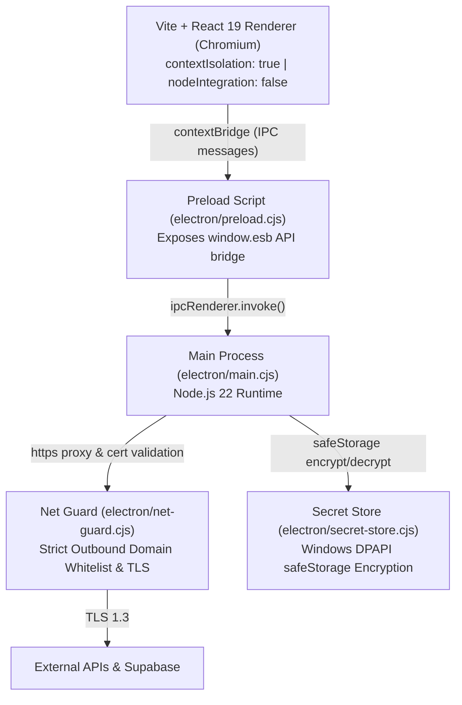

# ESB Studio — Desktop Architecture & Workstation Specification

> **Repository**: `C:\Users\hamim\esb-banner-studio`  
> **Runtime**: Electron 45, Node.js 22 LTS  
> **Frontend**: React 19.3, Vite 8, TypeScript ~6.0.3, Zustand 5  
> **Key Capabilities**: 4-Workspace Studio Shell, 2D Canvas Banner Engine, TipTap Rich Text, Video Timeline, Outreach Autopilot

---

## 1. Process Separation & Security Boundaries

Desktop ESB Studio enforces an enterprise-grade multi-process security model:



### 1.1 Process Security Rules
1. **Renderer Isolation**: The React frontend executes in an unprivileged web context. It has **no access to Node.js `require()`, `fs`, `child_process`, or `process`**.
2. **Context Bridge API (`window.esb`)**: Communication with the operating system occurs exclusively over strictly typed IPC channels defined in [preload.cjs](file:///C:/Users/hamim/esb-banner-studio/electron/preload.cjs).
3. **Hardware-Backed Secret Storage**: Sensitive credentials (AI API keys, Supabase service tokens, Facebook Page access tokens) are handled by [secret-store.cjs](file:///C:/Users/hamim/esb-banner-studio/electron/secret-store.cjs) using Chromium's `safeStorage` (backed by Windows Data Protection API - DPAPI). Plaintext keys are never stored in `localStorage` or disk files.
4. **Outbound Traffic Filtering**: [net-guard.cjs](file:///C:/Users/hamim/esb-banner-studio/electron/net-guard.cjs) intercepts all outbound HTTP/HTTPS requests from both main and renderer processes, rejecting unauthorized domains and enforcing strict TLS certificate chains (rejecting `rejectUnauthorized: false`).

---

## 2. Directory Layout & Module Structure

```
C:\Users\hamim\esb-banner-studio\
├── electron/                   # Electron Main & Preload scripts
│   ├── main.cjs                # Main process lifecycle, window creation, IPC handlers
│   ├── preload.cjs             # Typed contextBridge IPC exposure
│   ├── net-guard.cjs           # Strict network firewall & TLS validation
│   └── secret-store.cjs        # DPAPI safeStorage encrypted credential ledger
├── src/                        # React 19 Frontend Application
│   ├── shell/                  # Studio shell, navigation rail, workspace router, theme tokens
│   │   ├── Shell.tsx           # Primary application container
│   │   └── shellStore.ts       # Global navigation, notifications, workspace state
│   ├── editorial/              # Editorial Desk workspace
│   │   ├── EditorDesk.tsx      # Main editorial layout with TipTap rich text
│   │   ├── editorialStore.ts   # Article drafts, character budgets, publishing state
│   │   ├── extract.ts          # National portal news scraper & DOMPurify extractor
│   │   ├── aiProviders.ts      # Multi-model AI drafting & translation adapters
│   │   └── facebook.ts         # Facebook Page Graph API dispatcher
│   ├── components/ & core/     # Graphics Canvas Workspace
│   │   ├── Canvas.tsx          # High-DPI 2D HTML5 canvas renderer
│   │   ├── store.ts            # Banner graphics state (headline, typography, photo, aspect)
│   │   └── export.ts           # 2x PNG / WebP export pipeline
│   ├── video/                  # Video Workspace
│   │   ├── VideoStudio.tsx     # Video timeline, captions track, audio sync
│   │   └── videoStore.ts       # Video clips, keyframes, render pipeline
│   ├── outreach/               # Outreach Autopilot Workspace
│   │   ├── OutreachDesk.tsx    # Targeted media outreach, journalist syndicate ledger
│   │   └── outreachStore.ts    # Outreach campaigns, email sequences, CRM sync
│   ├── news/                   # Live News Watch
│   │   ├── NewsWatchDesk.tsx   # Automated news monitor & multi-source crawler
│   │   └── watchStore.ts       # Crawled feeds, duplicate filter, breaking alerts
│   └── styles/                 # Design system tokens & base CSS
│       ├── tokens.css          # 4px geometry tokens, color scales, typography
│       └── home.css            # Shell layout styling
├── tools/                      # Audits, verification scripts, and test runners
│   ├── audit/                  # Text-fit, optical center, contrast, and census audits
│   ├── e2e/                    # Playwright visual golden banner & editorial tests
│   └── unit/                   # Vitest unit test suites
└── package.json                # Project manifest and verification commands
```

---

## 3. Workspace State Management (Zustand 5)

Desktop ESB Studio isolates concerns across dedicated, non-overlapping Zustand stores:

| Store Module | File Path | Scope & Responsibility |
| :--- | :--- | :--- |
| `useShellStore` | `src/shell/shellStore.ts` | Active workspace (`editorial`, `graphics`, `video`, `outreach`), theme mode, notifications, status bar |
| `useEditorialStore` | `src/editorial/editorialStore.ts` | Article title, deck, body, category, author, status, live sync |
| `useStudioStore` | `src/store.ts` | Banner graphics canvas, typography metrics, photo layers, aspect ratios (`16:9`, `1:1`, `4:5`) |
| `useVideoStore` | `src/video/videoStore.ts` | Video clips, subtitle tracks, audio waveform, timeline scrubber position |
| `useOutreachStore`| `src/outreach/outreachStore.ts` | Campaigns, prospect lists, outreach email queues, dispatch metrics |
| `useWatchStore` | `src/news/watchStore.ts` | Live news ticker feeds, ingested source items, category filters |

### 3.1 Two-Way Synchronization Bridge
When an editor updates an article headline or category in `editorialStore`, the graphics canvas automatically synchronizes through cross-store synchronization hooks, updating the canvas banner layout without manual re-typing.

---

## 4. Verification & Quality Gates

Desktop code modifications must satisfy the 3-tier quality gate prior to acceptance:

1. **Static Analysis & Fast Lint**:
   ```bash
   npm run lint          # oxlint checks across src/ and tools/
   ```
2. **Unit Tests (Vitest)**:
   ```bash
   npm test              # runs isolated unit tests in tools/unit/
   ```
3. **Production Typecheck & Bundle**:
   ```bash
   npm run build         # tsc -b && vite build
   ```
4. **Visual & Geometry Audits (Mandatory for UI Changes)**:
   ```bash
   npm run audit:text-fit   # Verifies buttons, pills, tabs do not clip
   npm run audit:center     # Verifies icon/label alignment within 4px tokens
   node tools/e2e/golden-test.mjs  # Pixelmatch golden canvas visual regression
   ```
