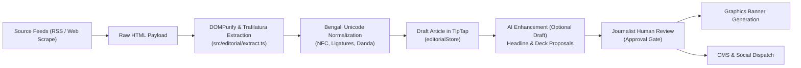

# ESB Studio — Editorial & Creative Workflows Specification

> **Workspace**: Editorial Desk (`src/editorial/`) & Graphics Canvas (`src/components/`, `src/core/`)  
> **Target Audience**: Energy Journalists, News Editors, Visual Designers  
> **Key Directives**: Accuracy Before Automation, Human-in-the-Loop, Bengali Typography Fidelity

---

## 1. Editorial Intake & News Extraction Pipeline

The editorial workflow ingests news leads from national portals, RSS feeds, and official government press releases (Ministry of Power, Energy & Mineral Resources, BPDB, Petrobangla, BERC).

### 1.1 Extraction Safety (`extract.ts`)
1. **Source Content Cleansing**: Raw HTML extracted from external links is passed through DOMPurify to strip tracking scripts, advert blocks, and navigation chrome.
2. **Author & Timestamp Extraction**: Metadata is parsed automatically from OpenGraph (`og:title`, `article:published_time`) and Schema.org JSON-LD microdata.
3. **Duplicate Prevention**: Ingested articles are hashed by URL and normalized title to prevent duplicate entries in `watchStore`.

---

## 2. Bengali Text Normalization & Typography Precision

Bengali digital typography faces unique encoding challenges across varying operating systems and web fonts. The editorial pipeline enforces standard Unicode normalization:

1. **Unicode NFC / NFKC Normalization**: All Bengali text strings are normalized via `str.normalize('NFC')` to ensure decomposed vowel markers (যেমন: ো = ে + া) are mapped into single composite code points.
2. **Punctuation Rules**:
   - The Bengali full stop (Dari `।` - `U+0964`) is enforced in headlines and body text instead of Latin periods (`.`).
   - Standard curly quotation marks (`“` and `”`) are preserved; straight ASCII quotes (`"`) are converted during editorial copy cleanup.
3. **OpenType Ligatures**: The font engine enforces OpenType ligatures (`"liga" 1, "kern" 1`) to ensure complex conjuncts (যুক্তবর্ণ: ক্ষ, জ্ঞ, ঞ্চ, ণ্ড, হ্ম) render with optical precision in **Hind Siliguri**.
4. **Line-Height Rule**: A strict minimum `line-height: 1.6` is maintained across all Bengali body copy to prevent ascender/descender collisions.

---

## 3. Human-in-the-Loop AI Principles

ESB Studio integrates advanced AI models (Gemini, Claude, GPT-4o) to accelerate reporting, but enforces non-negotiable editorial guardrails:

| Permitted AI Operation | Strictly Forbidden AI Operation |
| :--- | :--- |
| Generating draft headline alternatives within $\le 104$ chars | Inventing unverified figures, megawatts (MW), or financial amounts |
| Condensing article lead into a $\le 200$ char deck | Hallucinating source quotations or attributing claims to unnamed officials |
| Translating English energy reports into Bengali | Auto-publishing content directly to the CMS without human button press |
| Proofreading Bengali grammar and spelling | Overwriting an editor's manual edits without explicit confirmation |

---

## 4. Banner Canvas & Visual Asset Generation

Once an article is drafted and approved:

1. **Two-Way Synchronization**: The approved headline, deck, and category automatically populate the Graphics Canvas workspace (`useStudioStore`).
2. **Canvas 2D Rendering Engine**:
   - High-DPI canvas (2x / 4K scale factor) prevents blurriness on Retina/AMOLED displays.
   - Dynamic optical font kerning and multi-line wrapping ensure headlines never overflow the designated content box.
   - Category accent color strips (`--cat-*`) are applied based on the 10-category taxonomy.
3. **Social Export**:
   - Primary Aspect Ratios: `16:9` (Facebook/X Link Preview), `1:1` (Instagram/Feed), `4:5` (Mobile Portrait).
   - Export pipeline outputs optimized WebP and lossless 2x PNG assets.

---

## 5. Multi-Channel Publishing Gate

No story or asset goes live automatically:
1. **CMS Publishing**: Dispatches the validated article, Bengali headline, deck, author attribution, and featured banner to the ESB PowerLine CMS via authenticated REST endpoints.
2. **Social Media Dispatch**: Dispatches the generated banner and story link to the official Facebook Page using securely stored page access tokens (`facebook.ts`).
3. **Audit Trail**: Every publish action writes a permanent ledger entry to `public.Article` with the publishing editor's UUID and timestamp.
